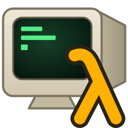
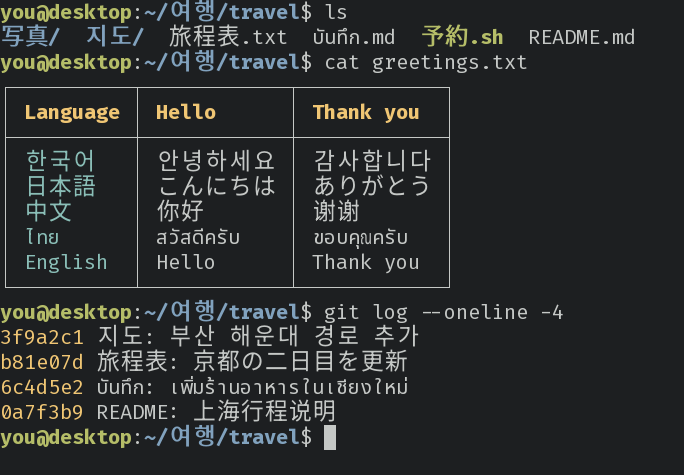
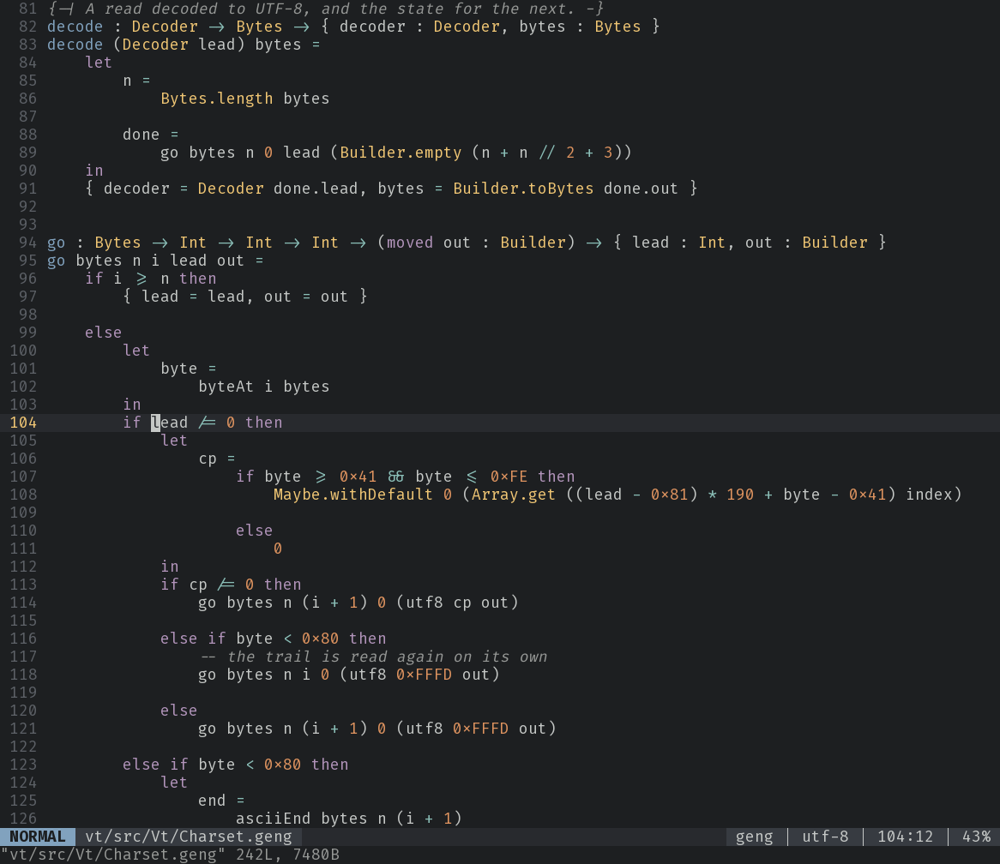

<p align="center"></p>

# puritty

**A terminal for Linux that stays fast when it runs on another machine, gets
Korean, Chinese, Japanese and Thai right, and gets out of your way.**



Most new terminals are built for one case: a local GPU, a local shell, UTF-8
everywhere. puritty is built for that case too, and for the ones they leave
behind: the terminal running on a remote host and drawn on your desktop over
`ssh -X` or a remote X session, the server whose locale is still EUC-KR, and
the IME that has to work the first time.

> **Status:** puritty is pre-release. It is its author's daily terminal on
> Linux Mint, and it will be published alongside the first alpha of
> [Geng](https://geng-lang.org), the language it is written in.
> Until then, building it needs the Geng toolchain (see
> [Building](#building)).

**Website and guide: <https://gilramir.github.io/puritty/>**

---

## Why puritty

### It is fast over remote X11

GPU terminals such as Alacritty, Ghostty and WezTerm draw every frame with
OpenGL. When they run on a remote host, that drawing happens on the remote
CPU and the whole window goes over the network as pixels: about **4.9 MB a
frame** for an ordinary window.

puritty has a renderer of its own for X11. It sends the X server text and
small instructions, not pictures. It keeps its own copy of the screen, sends
only what changed, and moves scrolled text with one copy on the server
instead of redrawing it. It never waits on a reply from the server while
drawing. Measured over `ssh -X`:

| what you're doing | what crosses the network |
|---|---|
| scrolling in vim | about 500 bytes a line |
| `tail -f` on a log | about 420 bytes a line |
| `htop` updating | about 8–10 KB a second |

That is level with classic core-font xterm, but with modern font
rendering, wide characters, true color and a modern feature set.
Remote X11 is a main path in puritty, not an afterthought.

### Korean, Chinese, Japanese and Thai, done properly

- **Input methods work.** puritty talks XIM directly, draws the text you are
  still composing at the cursor, and has a scripted test suite over six IME
  setups, among them fcitx5-hangul, ibus-hangul, Mozc and a pinyin IME.
- **Wide characters and grapheme clusters** take the cells they should,
  using the same Unicode width tables as Ghostty, and copy back out as
  the characters you see, not doubled.
- **Thai** is shaped, and **Han characters** are drawn in the regional forms
  for your language: set `language = "ja"` (or `ko`, `zh-CN`, ...) and the
  fallback fonts follow it. Left out, it is your locale's on Linux, and on
  Windows the first language in Settings' Language & region.
- **EUC-KR and CP949 are built in.** If you log in to hosts that still run
  `ko_KR.euckr`, set `charset = "euc-kr"` and puritty converts in both
  directions. You don't need `luit` or a wrapper script.

### Correct, and checked

The terminal core is tested against libghostty-vt on recorded sessions,
fuzzed, and run against the `esctest2` conformance suite, where it passes
386 of 567 tests (Ghostty 1.4 passes 388). Every buffer a remote program can
fill has a limit. puritty is written in Geng, a memory-safe language whose
compiler proves array and byte reads in range before it builds the program.



### Copy and paste that make sense

- Select with the mouse, double-click for a word, triple-click for a line,
  and choose for yourself which characters end a word.
- Middle-click (or right-click, PuTTY style) pastes the selection.
  Ctrl+Shift+C and Ctrl+Shift+V use the clipboard.
- A wrapped line copies back as one line, without trailing spaces.
- Programs that take the mouse (nvim, tmux, htop) keep it. Hold **Shift** to
  select anyway.
- Remote programs can copy to your clipboard with OSC 52, so a copy in tmux
  on a server reaches your desktop. Reading your clipboard is **denied** by
  default.

A full guide is in [`docs/user/copy-and-paste.md`](docs/user/copy-and-paste.md).

### Small things that add up

- **No terminfo to copy around.** puritty sets `TERM=xterm-256color`, which
  every host already knows, so ssh to a fresh server just works.
- **Scrollback** with the wheel or Shift+PgUp/PgDn, and **jump between shell
  prompts** with Ctrl+Shift+Up/Down (for shells that mark them with OSC 133).
- **Zoom** with Ctrl and the wheel, or Ctrl+=, Ctrl+− and Ctrl+0. The
  starting size comes from your screen's DPI, so text isn't tiny on a large
  monitor.
- **Bracketed paste**, so pasting a block of commands into a shell doesn't
  run them before you look.
- **Synchronized output** (mode 2026), so full-screen programs redraw without
  tearing.
- **No account, no login, no telemetry.** It is a terminal.

---

## Using it

```sh
puritty                         # your $SHELL in a new window (on Windows,
                                #   PowerShell 7, else Windows PowerShell, else cmd)
puritty -- htop                 # any program
puritty --title notes -- vim -O a.txt b.txt
puritty --config ~/work.toml    # another settings file
```

### Settings

puritty reads `~/.config/puritty/config.toml` (on Windows
`%APPDATA%\puritty\config.toml`). Every key is optional, and a change
to the file is applied to every open window at once, except the window's
size and the program, which new windows take. A key puritty doesn't know,
or a value a setting doesn't take, is reported with its line and the
nearest setting's name (`font.sise`: did you mean `font.size`?) rather
than silently ignored, and puritty goes on with the rest: the report is
on standard error, at the top of a new window, and on the title until the
file is fixed.

Hosts are kept in the same file, and `puritty --host NAME` connects to one
with OpenSSH, in the host's own colors and font:

```toml
[hosts."build-box"]
host = "build.example.com"
user = "gilbert"
jump = "bastion"                 # another host, or user@host:port
command = "tmux new -A -s main"

[hosts."build-box".colors]
background = "#2a1010"
```

`puritty ssh user@host:port` connects without saving a host, and a name
the file doesn't have is passed to `ssh`, so your `~/.ssh/config` aliases
work as they are. `puritty hosts` opens a list of your hosts (and those in
`~/.ssh/config`) with a quick-connect field; choosing one turns that window
into the session, as PuTTY's dialog does. `start = "hosts"` at the top of
the file makes plain `puritty` open that list, and `start =
"host:build-box"` connect straight there; `puritty shell` still opens a
local shell.

`puritty settings` opens a window to change them without editing the file:
search, a page of settings at a time, each change written to the file and
taken by every open window as you make it, Ctrl+Z to undo, with the keys
or the mouse. It edits the file in place and keeps your comments, and its
Hosts page adds, changes, copies, renames and removes hosts. Ctrl+Comma
opens it from any window, and Ctrl+right-click opens a menu of it, the
host list, a new window and your hosts (on Windows the same items are in
the window's system menu).

```toml
[window]
columns = 120
rows = 36

[font]
family = "Fira Code"        # as fontconfig names it; DejaVu Sans Mono
                            # when left out, Cascadia Mono on Windows
size = 11                   # points
language = "ko"             # which regional forms fallback fonts use

[colors]
foreground = "#c5c8c6"
background = "#1d1f21"
palette = ["#1d1f21", "#cc6666", "#b5bd68", "#f0c674"]   # the 16 named colors, from 0

[terminal]
charset = "utf-8"           # or "euc-kr", "cp949"

[scrollback]
lines = 25000

[selection]
word_boundaries = " \t'\"│`|:;,()[]{}<>$"

[mouse]
paste_button = "middle"     # or "right"

[clipboard]
osc52_read = "deny"         # or "allow"
```

---

## What's coming

Built so far, beyond the terminal itself: the settings window (English and
Korean), the host list with quick connect, Windows with the ssh client built
in, and the first part of **tmux control mode** (`tmux -CC`), where tmux's
tiled, floating and modal panes are drawn as puritty's own
([the tmux guide](docs/user/tmux.md)). Next, in roughly this order:

1. **The rest of tmux control mode**: what the panes held when you attach,
   tmux's windows as tabs, the mouse on panes, scrollback and selection
   within a pane.
2. **Inline images**: Sixel, Kitty graphics and iTerm2 images.
3. **Scrollback search**, a scrollbar, and **key bindings** in the config.
4. **Key sounds**, an optional typewriter click as you type.
5. **RHEL 8**, built against its older libraries.
6. **A signed Windows release**, and passwords kept in the Windows
   credential store.

---

## Building

puritty is a Geng program with a small amount of C for X11, fonts and the
input method. Until Geng's first release, a build needs a
geng-lang checkout ([geng-lang.org](https://geng-lang.org)) with its
compiler built, and the libraries in this repository's `devbox.json`
(libxcb, xkbcommon, FreeType, HarfBuzz, fontconfig). From the repository:

```sh
devbox shell
app/build.sh        # writes app/puritty
```

`app/release.sh` builds the same program for a release: it trains a
profile of the terminal core on the benchmark inputs first and compiles
with it, which makes the core 5% to 25% faster
([`docs/vt-core.md`](docs/vt-core.md) §VC54, §VC56). It needs the
benchmark inputs in `.harness-work/perf/inputs` (`harness/perf.py
--inputs DIR`) and takes a few minutes more; day-to-day builds use
`app/build.sh`.

It runs on Linux under X11, locally or over `ssh -X`.

---

## Acknowledgments

puritty learned from the terminals that came before it. Its design started
from close readings of Alacritty, Ghostty, WezTerm, Windows Terminal and
PuTTY (see [`docs/`](docs/)). Its key encoder, mouse encoder and Unicode
widths follow Ghostty's, and libghostty-vt is the reference its core is
tested against.
