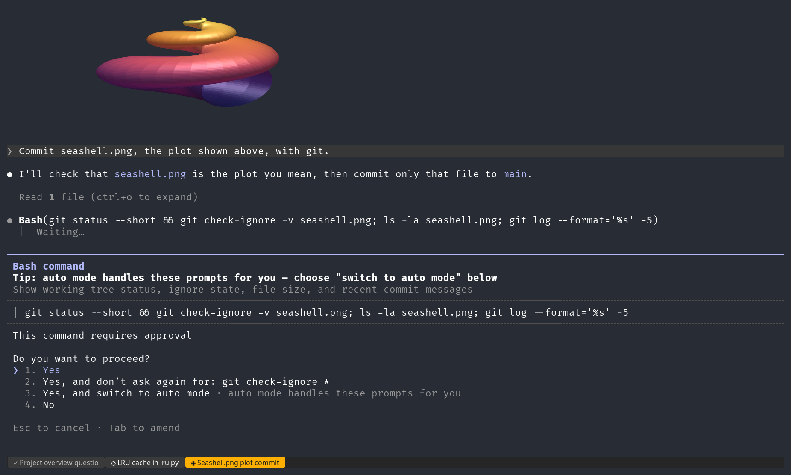

# Claude Code in puritty



*Three Claude Code sessions in one window. The tabs show which one is
done (✓), which is still working (◔), and which is waiting on you (◉).
The seashell in the shown tab is a picture a mod drew in the conversation.*

Claude Code asks the terminal what it can do when it starts, and puritty
answers. Most of what follows works with nothing set.

## What works by itself

- **Each tab shows what Claude Code is doing.** Claude Code reports its
  state (the Program Status Protocol, OSC 7501), and puritty marks the tab
  and the window's title: ◔ working, ◉ waiting on you (a permission
  question, say), ✓ done, ✗ failed. When a tab you aren't looking at
  comes to wait on you, finishes or fails, the window asks for your
  attention (the taskbar flashes or the window is marked urgent) and the
  bell sounds, once.
- **Shift+Enter starts a new line** in Claude Code's prompt, and the
  other keys Claude Code reads are told apart, through the kitty keyboard
  protocol.
- **No flicker**: Claude Code draws each frame whole, with synchronized
  output.
- **The mouse in pixels**, for Claude Code's fullscreen view
  (`CLAUDE_CODE_NO_FLICKER=1`). It works in the panes of `tmux -CC` too.
- **Links**: puritty tells Claude Code it can show links
  (`FORCE_HYPERLINK=1`, set for every program it starts), and Ctrl+click
  opens one, in the fullscreen view too.

## What to turn on

Claude Code decides some things by the terminal's name, and it doesn't
know puritty's name yet. Two settings tell it what puritty can do.

**Pictures.** Mods can draw pictures in Claude Code, and puritty draws
them (Kitty's graphics), whether a mod gives the picture itself or names
its file. A mod that names a file needs "Pictures from files" turned
on, since that's off by default
([pictures from files](images.md#pictures-from-files)). Set this before
you start Claude Code, in your shell's startup file:

```sh
export CLAUDE_CODE_FORCE_TERMINAL_IMAGES=1
```

**Desktop notifications.** Claude Code can tell you it's waiting through
the desktop's notifications. In `~/.claude/settings.json`, choose one of
the three kinds puritty shows:

```json
{ "preferredNotifChannel": "ghostty" }
```

`"iterm2"` and `"kitty"` work as well. puritty shows at most one
notification every 3 seconds. To have none, turn off "Desktop
notifications" on the settings window's Program page, or set it in
`config.toml`:

```toml
[notifications]
desktop = false
```

On Linux, puritty shows notifications with `notify-send`, which most
desktops have; on Windows, as a toast.

## Leave TERM_PROGRAM alone

Don't set `TERM_PROGRAM` to another terminal's name to get its features.
Claude Code would then believe it's in that terminal, and use the ways
that terminal does things, some of which puritty doesn't share. puritty
answers Claude Code's questions itself.

## Under tmux and on Windows

- **Inside tmux**, `tmux -CC` too, Claude Code asks tmux what the
  terminal can do, not puritty. tmux doesn't pass the status on, so the
  tabs show no state, and tmux decides the rest.
- **Claude Code run on Windows itself** goes through Windows' console,
  which drops synchronized output, pictures and the mouse in pixels on the
  way. Claude Code run on another machine, through puritty's own ssh
  client, has all of them.
