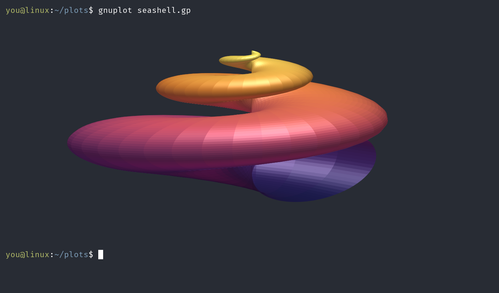

# Pictures in the terminal



*gnuplot drawing a seashell in puritty, under the command that drew it.*

Programs can show pictures in puritty: plots from `gnuplot`, photos from
`chafa` or `timg`, previews in the file manager `yazi`, images in Neovim
with snacks.nvim, and the Rust programs built on ratatui-image. There is
nothing to install or turn on.

A program sends a picture in one of three ways, and puritty understands
all three:

- **Kitty's graphics**: full color, and the one to prefer where a program
  offers a choice. Its *Unicode placeholders* work too: the picture is
  drawn under special characters in the text, so it scrolls and is erased
  with the text around it. snacks.nvim and ratatui-image use them.
- **Sixel**: the oldest, from DEC's terminals, which almost every
  picture program can send. A Sixel picture has a palette, so it can
  show fewer colors than the other two.
- **iTerm2's images**: a PNG, a JPEG or a GIF (its first frame), sent as
  the file is.

## Programs that ask

These ask puritty what it can do and choose by themselves:

- **gnuplot** draws with the terminal you name: `set term kittycairo
  scroll` for Kitty's graphics, or `set term sixelgd truecolor scroll`
  where gnuplot was built without cairo. `scroll` draws the plot where the
  cursor is, under the command. The seashell above is
  [its script](https://gilramir.github.io/puritty/plots/seashell.gp).
- **yazi** shows its previews by itself.
- **ratatui-image's programs** use Kitty's graphics by themselves.

## Programs that know terminals by name

Some programs don't ask: they look for a terminal they know by name, from
an environment variable such as `TERM_PROGRAM` or from the name the
terminal gives when asked (XTVERSION). They don't know puritty's name
yet, so they need telling. Set these where the program runs, which over
ssh is the remote host, in your shell's startup file there (`~/.bashrc`,
`~/.zshrc`):

- **chafa** finds Sixel by itself and draws with it. For full color, tell
  it to use Kitty's graphics, each time or with an alias:

  ```sh
  chafa -f kitty photo.jpg
  alias chafa='chafa -f kitty'
  ```

- **timg** also finds Sixel by itself. For Kitty's graphics, use `-pk`,
  or set it once:

  ```sh
  export TIMG_PIXELATION=kitty
  ```

- **snacks.nvim** (Neovim) shows pictures only in the terminals it knows,
  and in puritty shows none at all until told which one to act as. Tell
  it puritty works as Ghostty does:

  ```sh
  export SNACKS_GHOSTTY=1
  ```

## Over ssh, on Windows too

Pictures travel in the program's output, so they work the same over ssh,
with OpenSSH or with puritty's own ssh client on Windows.

## Pictures from files

With Kitty's graphics, a program on the same computer can name a picture's
file instead of sending it, and puritty reads the file. Claude Code's mods
do this. puritty reads only an ordinary file of at most 400 MB, never one
under `/proc`, `/sys` or `/dev`; a *temporary* file must be in a
temporary folder, with `tty-graphics-protocol` in its name, and puritty
deletes it once read. puritty only shows the picture: what it reads never
goes back to the program.

This is off until you turn it on, because a program you reach with
`ssh` in a puritty tab can't be told apart from a local one: with it on,
such a program could name a file on your computer and have it shown on
your screen. Kitty and Ghostty read such files without asking. A session
in puritty's own ssh client never makes puritty read a file, nor does a
pane of `tmux -CC`, even with it on. To turn it on, use "Pictures from
files" on the settings window's Advanced page, or:

```toml
[images]
read_files = true
```

## In tmux

With puritty's tmux integration (`tmux -CC`, see
[tmux in puritty](tmux.md)), pictures work in any tmux, by any of the
three ways, and each pane keeps its own pictures as you split, zoom and
resize. Two things are tmux's, not puritty's:

- A picture shown before you attached, or before you reconnected, does
  not come back: tmux keeps only the text.
- A program asks *tmux* what the terminal can do, so under an older tmux
  it may choose none unless told (`chafa -f sixels`).

In plain tmux (without `-CC`), pictures need tmux 3.4 or later built with
Sixel, and tmux passes only Sixel: Kitty's and iTerm2's pictures are
dropped unless the program wraps them for tmux, as `timg` does.

## Text over a picture

Text written over a Sixel or iTerm2 picture takes the picture's place in
those cells, and erasing cells (`clear`, deleting a line) erases the
picture there too, as in xterm. A Kitty picture stays until the program
removes it or the screen is cleared. In tmux's panes it behaves as a
Sixel picture does, so tmux's `clear` takes it.

## Limits

Very large pictures are refused. When pictures together take more than
320 MB, the oldest that are no longer on the screen go first.
