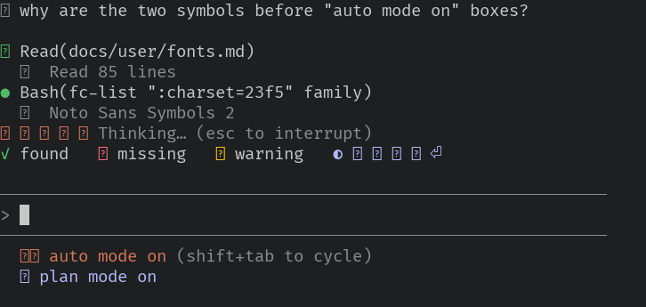
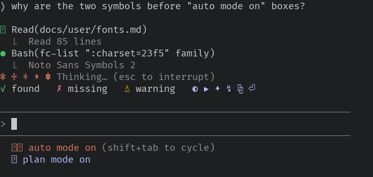
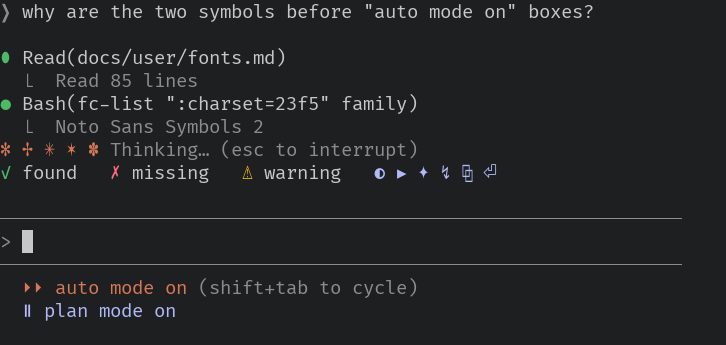
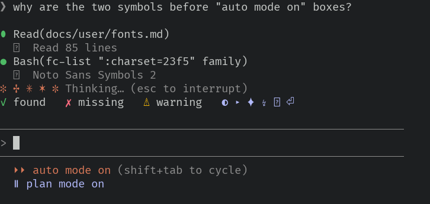
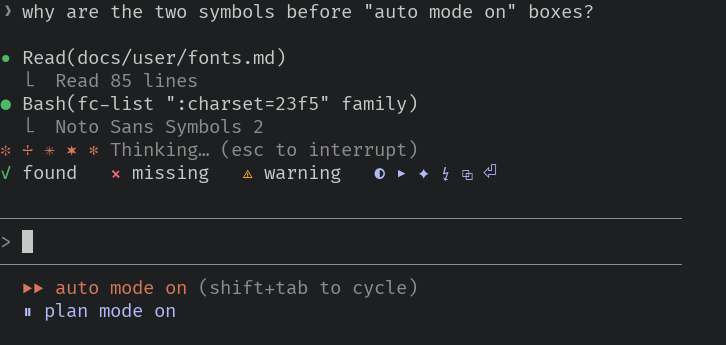
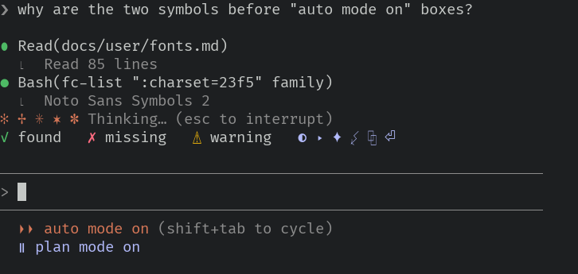
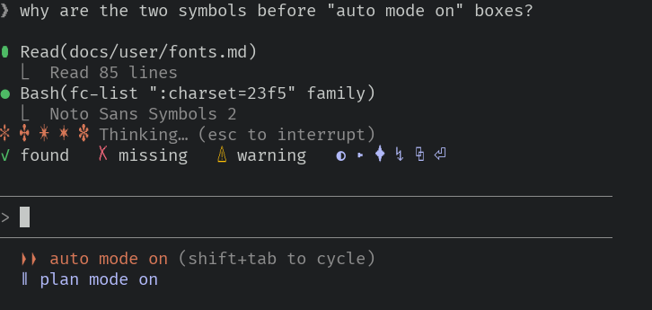

# Fonts for symbols

Programs in a terminal draw more than letters: Claude Code puts `⏵⏵` before
"auto mode on" and `⏺` before each step, and other programs use stars,
check marks, arrows and boxes. A programming font such as Fira Code has
only a few of these. When yours lacks one, puritty finds another installed
font that has it. When **no** installed font has it, puritty draws an empty
box in its place (often called *tofu*).

This page compares the fonts that fill the gaps, with pictures of each
drawing the same Claude Code screen in puritty. Your main font stays what
it is: these are only drawn for characters it doesn't have. Installing one
is the same as installing any font for yourself ([Installing a font for
yourself](fonts.md)); there is nothing to set in puritty.

**In short:** on RHEL 8 or RHEL 9, install **Noto Sans Symbols 2**. Windows,
Ubuntu and Linux Mint already have what they need.

---

## Why RHEL shows boxes

Fira Code alone, with no other fonts, draws 4 of the 20 symbols Claude Code
uses:



RHEL 8 has DejaVu Sans and an older Noto Sans Symbols (2016), which fill in
most of the rest, but not `⏵`, `⏸` or `⏺`: no font RHEL 8 or RHEL 9
offers has them, EPEL included. So "auto mode on" and "plan mode on" lose
their symbols, and the steps their bullets:



With Noto Sans Symbols 2 added, every symbol is drawn:



**Elsewhere:** Windows has all 20 in Segoe UI Symbol, which comes with
Windows. Ubuntu and Linux Mint have Noto Sans Symbols 2 already (package
`fonts-noto-core`, installed with the desktop).

---

## Which font has which symbol

The symbols Claude Code draws, and which fonts have them (✔ has it, · does
not):

| font | ❯ | ⏵ | ⏸ | ⏺ | ● | ⎿ | ✻ | ✢ | ✳ | ✶ | ✽ | ⧉ | ⏎ | ↯ | ✓ | ✗ | ⚠ | ◐ | ▸ | ✦ | of 20 |
|---|---|---|---|---|---|---|---|---|---|---|---|---|---|---|---|---|---|---|---|---|---|
| Fira Code 6.2 | · | · | · | · | ✔ | · | · | · | · | · | · | · | ✔ | · | ✔ | · | · | ✔ | · | · | 4 |
| JetBrains Mono 2.304 | ✔ | · | · | · | ✔ | · | · | · | · | ✔ | · | · | ✔ | · | ✔ | ✔ | ✔ | · | ✔ | · | 8 |
| Cascadia Code 2407 | ✔ | · | · | · | ✔ | · | · | · | · | · | · | · | ✔ | · | ✔ | · | · | ✔ | ✔ | · | 6 |
| DejaVu Sans Mono (RHEL 8) | ✔ | · | · | · | ✔ | · | ✔ | ✔ | ✔ | ✔ | ✔ | · | ✔ | ✔ | ✔ | ✔ | ✔ | ✔ | ✔ | ✔ | 15 |
| Noto Sans Symbols (RHEL 8) | ✔ | · | · | · | ✔ | ✔ | ✔ | ✔ | ✔ | ✔ | ✔ | ✔ | ✔ | ✔ | ✔ | ✔ | ✔ | ✔ | ✔ | ✔ | 17 |
| Noto Sans Symbols 2 | ✔ | ✔ | ✔ | ✔ | ✔ | · | ✔ | ✔ | ✔ | ✔ | ✔ | · | ✔ | ✔ | ✔ | ✔ | ✔ | ✔ | ✔ | ✔ | 18 |
| JuliaMono | ✔ | ✔ | ✔ | ✔ | ✔ | ✔ | ✔ | ✔ | ✔ | ✔ | ✔ | ✔ | ✔ | ✔ | ✔ | ✔ | ✔ | ✔ | ✔ | ✔ | 20 |
| Symbola 9.17 | ✔ | ✔ | ✔ | ✔ | ✔ | ✔ | ✔ | ✔ | ✔ | ✔ | ✔ | ✔ | ✔ | ✔ | ✔ | ✔ | ✔ | ✔ | ✔ | ✔ | 20 |
| GNU Unifont 15.1 | ✔ | ✔ | ✔ | ✔ | ✔ | ✔ | ✔ | ✔ | ✔ | ✔ | ✔ | ✔ | ✔ | ✔ | ✔ | ✔ | ✔ | ✔ | ✔ | ✔ | 20 |
| Segoe UI Symbol (Windows) | ✔ | ✔ | ✔ | ✔ | ✔ | ✔ | ✔ | ✔ | ✔ | ✔ | ✔ | ✔ | ✔ | ✔ | ✔ | ✔ | ✔ | ✔ | ✔ | ✔ | 20 |
| Symbols Nerd Font Mono | ✔ | · | · | · | · | · | · | · | · | · | · | · | · | · | · | · | · | · | · | · | 1 |

Noto Sans Symbols 2 misses `⎿` and `⧉`, but RHEL's own Noto Sans Symbols
has both, so together they cover all 20.

---

## The fonts

Each picture is puritty drawing the screen in Fira Code with that font as
the **only** other font, so every symbol Fira Code lacks comes from it.

### Noto Sans Symbols 2 (recommended for RHEL)



- **Get it:** <https://fonts.google.com/noto/specimen/Noto+Sans+Symbols+2>,
  or the one file directly:
  <https://github.com/notofonts/notofonts.github.io/raw/main/fonts/NotoSansSymbols2/hinted/ttf/NotoSansSymbols2-Regular.ttf>
- **License:** SIL Open Font License 1.1.
- **Pros:** one file of 670 KB. It is the font Ubuntu and Linux Mint draw
  these symbols with, so Claude Code looks on RHEL as it does there. It
  covers exactly what RHEL lacks (`⏵ ⏸ ⏺`), and its symbols are drawn to
  match Noto's other fonts.
- **Cons:** it lacks `⎿` and `⧉` (RHEL's Noto Sans Symbols has them, as
  above). Some symbols are drawn small, `⏵` and `⏸` among them, since it
  isn't made for a terminal's cells.

### JuliaMono



- **Get it:** <https://juliamono.netlify.app/>; the files are on
  <https://github.com/cormullion/juliamono/releases> (`JuliaMono-ttf.tar.gz`;
  `JuliaMono-Regular.ttf` is the one needed).
- **License:** SIL Open Font License 1.1.
- **Pros:** all 20, and over 11,000 characters in all. It is a monospace
  font, so its symbols are drawn to fill a cell, and they sit evenly beside
  Fira Code. It could be your main font too.
- **Cons:** larger (3.2 MB for the regular weight). Its symbols are plainer
  and lighter than Noto's.

### Symbola



- **Get it:** Debian and Ubuntu's package `fonts-symbola` (version 9.17);
  on RHEL, the file `Symbola_hint.ttf` taken from that package
  (<https://packages.debian.org/stable/fonts-symbola>).
- **License:** the 9.17 that Debian ships says "free for any use". The
  author's later versions carry a more restrictive license, so check it
  before using one of those at work.
- **Pros:** all 20, and most of Unicode's symbols besides (9,600
  characters).
- **Cons:** not packaged for RHEL, and the newer versions' license. Its
  style is a book face's, finer than Fira Code beside it.

### GNU Unifont



- **Get it:** <https://unifoundry.com/unifont/>; `unifont-VERSION.otf`.
- **License:** GPL 2 or later, with the GNU font embedding exception.
- **Pros:** nearly every character of Unicode's first 65,536 (57,000 in
  this file), so almost nothing is ever a box.
- **Cons:** it is a bitmap font made into outlines, 16 pixels high: its
  symbols look pixelated at most sizes, and coarse next to Fira Code. A
  last resort rather than a first choice.

### Fonts that don't help here

- **Symbols Nerd Font** (<https://www.nerdfonts.com/>) has over 10,000
  icons for shell prompts and editors, but they are in Unicode's private
  use area; of Claude Code's symbols it has only `❯`.
- **JetBrains Mono** and **Cascadia Code**, as main fonts, have a few more
  of these symbols than Fira Code (8 and 6 of 20), but not `⏵ ⏸ ⏺`.
- **LibreOffice's OpenSymbol**, often installed on RHEL, has none of
  `⏵ ⏸ ⏺`.

---

## Installing one on RHEL

As in [Installing a font for yourself](fonts.md), on the machine puritty
runs on (with ETX or `ssh -X`, the remote one):

```sh
mkdir -p ~/.local/share/fonts
cd ~/.local/share/fonts
curl -LO https://github.com/notofonts/notofonts.github.io/raw/main/fonts/NotoSansSymbols2/hinted/ttf/NotoSansSymbols2-Regular.ttf
fc-cache -f ~/.local/share/fonts
fc-list ":charset=23f5" family
```

The last line lists the fonts that have `⏵`; "Noto Sans Symbols 2" should
be among them. If boxes stay on the screen, restart puritty.
