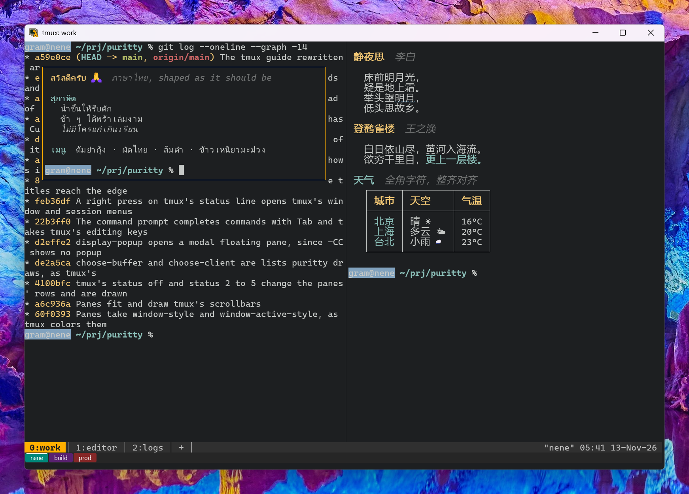

# tmux in puritty



*puritty on Windows 11, connected to a Linux host with its built-in ssh
client, running `tmux -CC attach` with tmux 3.8: three tiled panes, and a
floating pane over them.*

There are two ways to use tmux in puritty: as in any terminal, where tmux
draws everything itself, or in **control mode**, where puritty draws
tmux's panes itself.

## Control mode: tmux's panes as puritty's own

Start or attach to tmux with `-CC`:

```
tmux -CC new -A -s main      # attach to "main", or make it
tmux -CC attach              # attach to the last session
```

tmux then stops drawing and tells puritty what is in each pane and where the
panes are, and puritty draws them:

- **Tiled panes** where tmux puts them, with a line between them.
- **Floating and modal panes** (tmux 3.7 and later) in boxes over the tiled
  ones, the topmost last. They stay inside the window, as tmux keeps them.
- **What you type** goes to tmux's active pane, and when you resize the
  window, tmux lays its panes out again for the new size.
- **Colours, Korean and other wide characters, and every other escape** a
  program writes are drawn by puritty's own terminal for each pane.

`-CC` belongs to the client: your tmux server and sessions are as they
always were, and a plain `tmux attach` from another terminal still works on
the same session. Detach, or lose the connection, and `tmux -CC attach`
brings the same panes back. A host in puritty's settings can do it for you
each time you connect:

```toml
[hosts."build-box"]
host = "build.example.com"
command = "tmux -CC new -A -s main"
```

Control mode needs tmux 3.2 or later; floating panes need 3.7 or later.

### What you can do

- **Attach to a session that's already running**: every pane comes back as
  it was, its history, colours and cursor, and a program like `less` or
  vim on its own screen.
- **Tabs**: the bottom row shows the session's windows, where tmux's
  status line was (`tabs = "top"` under `[tmux]` in the settings puts it
  at the top). Click one to switch, `+` or **Ctrl+Shift+T** for a new
  window, **Ctrl+PgUp** and **Ctrl+PgDn** to move between them. A window
  closes when its programs end; the tab bar has no close button, since
  closing a window ends what runs in it.
- **The mouse**: click a pane to make it the active one (its box, if it
  floats, turns amber). Drag a floating pane by its top edge to move it,
  by its other edges to resize it, and drag the line between two panes to
  give one more room. Programs that use the mouse, such as vim or htop,
  get it in their own pane; hold **Shift** to select over them instead.
- **Scrollback and selection, pane by pane**: the wheel or
  **Shift+PgUp/PgDn** scroll the pane under the pointer or the active one;
  drag, double-click or triple-click selects within one pane, its
  scrollback included, and copies as everywhere else in puritty.
- **Slow connections**: if puritty falls behind on a pane over a slow
  link, tmux pauses it, and puritty picks it up again where it is, without
  losing what it printed.
- **Your key bindings**: keys go through tmux's own key tables, so your
  prefix (say **Ctrl+A**) and your `bind` and `bind -n` keys work as in
  plain tmux. This needs tmux 3.4 or later on the server; with an older
  tmux, typing works but the prefix does nothing, and the tab bar says so.
  Messages from tmux (`prefix i`, an error such as "can't find window")
  show at the right of the tab bar until the next key.
- **tmux's prompts and questions**: the command prompt (`prefix :`),
  renaming (`prefix ,`, `prefix $`), yes-or-no questions (`prefix x`,
  `prefix &`) and copy mode's search and counts (`/`, `?`, `3k`) open a box
  over the window, which runs what tmux would run when you answer. Typing
  works as on tmux's own prompt line: Left, Right, Home, End, Ctrl+A,
  Ctrl+E, Ctrl+U, Ctrl+K, Ctrl+W, and Up and Down for earlier answers;
  Escape cancels. Korean typed with an input method, or pasted, goes into
  it. To have them on the bottom row in tmux's own yellow instead, set:

  ```toml
  [tmux]
  look = "tmux"
  ```

- **Lists tmux prints**: `prefix ?` (the key bindings), `prefix #` (the
  paste buffers), `prefix ~` (tmux's messages), and anything a command from
  `prefix :` prints, open in a box you scroll with the arrows, `j` and `k`,
  PgUp and PgDn, Space, `g` and `G`; `q` or Escape closes it. With `look =
  "tmux"` they cover the active pane, with tmux's `[n/m]` at the top right,
  as tmux shows them.

Not yet under `-CC`: copy mode and tmux's other modes (choose-tree, the
clock) change what tmux does but puritty does not draw them yet, so copy
mode's cursor and selection are not shown; nor are tmux's menus. `prefix Ctrl+Z` does nothing and says
why in the tab bar, since tmux would then take no more keys from puritty.

## tmux drawing for itself

tmux asks the terminal it runs in what it can do, and turns its features on
from the answers. puritty answers:

- its **colours**, so tmux knows whether your background is dark or light
  and picks its own colours to match (tmux 3.8's themes). If you change
  puritty's background in the settings, tmux hears about it at once;
- that it has **left and right margins** and **OSC 52 clipboard writes**;
- its name and version, `puritty 0.1.0`.

Answering promptly also means **Esc is not held for half a second** right
after you attach. tmux waits that long on a lone Esc while any of its
questions is unanswered.

## A line for your `.tmux.conf`

tmux does not know puritty by name yet, so a few features puritty has stay
off unless you name them. Put this in `~/.tmux.conf` (on the host where you
run tmux, if that is over ssh):

```
set -as terminal-features 'xterm*:extkeys:usstyle:overline'
set -g extended-keys on
```

- `extkeys` and `extended-keys on`: keys such as Ctrl+Shift+letter and
  Ctrl+Enter reach programs inside tmux as themselves.
- `usstyle`: curly, dotted and coloured underlines (spelling and lint marks
  in nvim).
- `overline`: lines over text.

puritty runs programs with `TERM=xterm-256color`, so the `xterm*` pattern
matches it. Check what tmux turned on with
`tmux display -p '#{client_termfeatures}'`.

## Korean text in EUC-KR

tmux keeps everything as UTF-8. Text a program writes in EUC-KR does not
survive tmux: tmux 3.6 and later show `�` in its place, older ones drop it.
tmux 2.7 (RHEL 8's) does not start in an EUC-KR locale at all. Inside tmux,
work in UTF-8: switch the host's locale to UTF-8 before starting tmux,
and set puritty's character set for that session to UTF-8 too.
