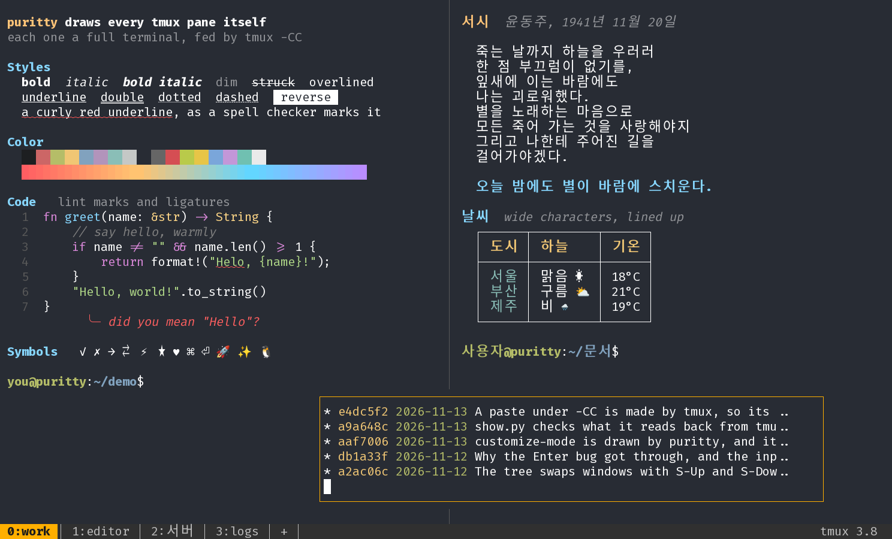

# tmux in puritty



*`tmux -CC attach` with tmux 3.8: two panes, each a full terminal of
puritty's (every text style on the left, Korean on the right), a floating
pane over them, and tmux's windows as tabs. Ghostty's colors, Fira Code.*

There are two ways to use tmux in puritty:

- **Control mode** (`tmux -CC`): tmux stops drawing and puritty draws
  tmux's panes itself, each a terminal of its own, with tmux's windows as
  tabs. Most of this guide is about it.
- **As in any terminal** (plain `tmux`): tmux draws everything, and
  puritty is the terminal it draws in. See
  [tmux drawing for itself](#tmux-drawing-for-itself).

## Starting control mode

Start or attach to tmux with `-CC`:

```
tmux -CC new -A -s main      # attach to "main", or make it
tmux -CC attach              # attach to the last session
```

`-CC` belongs to the client: your tmux server and sessions are as they
always were, and a plain `tmux attach` from another terminal still works on
the same session. Detach, or lose the connection, and `tmux -CC attach`
brings the same panes back, with their history, colors and cursors, and a
program like `less` or vim on its own screen.

A host in puritty's settings can do it each time you connect:

```toml
[hosts."build-box"]
host = "build.example.com"
command = "tmux -CC new -A -s main"
```


*On Windows 11, connected to Linux with puritty's own ssh client, running
`tmux -CC attach`: tmux's windows as tabs, and below them three tabs of
puritty's own, each in its color.*

### Which tmux

| tmux on the server | what you get |
|---|---|
| 3.2 or later | control mode: panes, tabs, the mouse, scrollback, selection |
| 3.4 or later | your prefix and key bindings (with an older tmux typing works, but the prefix does nothing, and the tab bar says so) |
| 3.7 or later | floating panes |
| 3.8 | modal panes and `display-popup`; tmux's themes; customize mode's hooks, environment and "changed only" view |

puritty is checked against tmux 3.6 and 3.8 side by side with tmux's own
client: screen by screen, and byte by byte for keys, the mouse and
pastes.

## Windows and panes

- **Tiled panes** are where tmux puts them, with a line between them.
  Resize puritty's window and tmux lays its panes out again for the new
  size.
- **Floating and modal panes** are drawn in boxes over the tiled ones,
  the topmost last, and stay inside the window as tmux keeps them. The
  active pane's box is amber.
- **Popups** (`display-popup`, which many plugins bind) open as a modal
  floating pane with tmux 3.8; earlier versions have no floating panes to
  put them in, and the tab bar says so.
- **Every pane is a full terminal**: colors (256 and 24-bit), bold,
  italic, every underline style (curly, dotted, dashed, double, colored),
  overline, wide characters such as Korean, and emoji, drawn by puritty's
  own terminal for each pane.
- **Tabs**: the bottom row shows the session's windows, where tmux's
  status line was. Click one to switch, `+` or **Ctrl+Shift+T** for a new
  window, **Ctrl+PgUp** and **Ctrl+PgDn** to move between them. A window
  that rang its bell has a red tab with `!`, one with activity `#`. A
  window closes when its programs end; the tab bar has no close button,
  since closing a window ends what runs in it. `tabs = "top"` under
  `[tmux]` puts the bar at the top.
- **Marks and titles**: the marked pane (`prefix m`) is framed in
  magenta; with `set -g pane-border-status top` (or `bottom`) each pane's
  title is on its border.
- **Slow connections**: if puritty falls behind on a pane over a slow
  link, tmux pauses it, and puritty picks it up again where it is,
  without losing what it printed.

## Keys

Keys go through tmux's own key tables, as on any terminal attached to
tmux: your prefix (say **Ctrl+A**) and your `bind` and `bind -n` keys work
as in plain tmux, and a key no binding takes goes to the active pane's
program exactly as tmux's own client would send it. Arrows, function keys,
Ctrl+Shift combinations (with `extended-keys`, see
[below](#a-line-for-your-tmux-conf)) and keypad keys all arrive as the
program asked for them.

Messages from tmux (`prefix i`, an error such as "can't find window") show
at the right of the tab bar until the next key.

`prefix Ctrl+Z` (suspend) does nothing and says why in the tab bar: tmux
would take no more keys from puritty afterwards.

## The mouse

- **Click** a pane to make it the active one.
- **Drag** a floating pane by its top edge to move it, by its other edges
  or corners to resize it, and drag the line between two tiled panes to
  give one more room. The pointer shows what a press would do: a
  two-headed arrow over a line or an edge that resizes, a four-headed one
  over a box's top edge, the plain arrow over the tab bar.
- **Programs that use the mouse**, such as vim or htop, get it in their
  own pane, at their own cell; hold **Shift** to select over them
  instead.
- **The right button**, when tmux's `mouse` option is on, opens tmux's
  menu for the pane, with its items for the word under the pointer; on
  tmux's status line (in tmux's look) a window's or the session's menu.
  **Ctrl+right-click** opens puritty's own menu, which under `-CC` has
  **Customize tmux…**.

## Scrollback, selection and paste

- **Each pane scrolls on its own**: the wheel scrolls the pane under the
  pointer (or sends arrow keys when its program is on the alternate
  screen, as without tmux), and **Shift+PgUp/PgDn** scroll the active one.
  A key you type brings it back to the bottom.
- **Selection stays within one pane**: drag, double-click a word,
  triple-click a line; it covers the pane's scrollback and joins wrapped
  lines, and copies as everywhere else in puritty
  ([Copy and paste](copy-and-paste.md)).
- **Pasting** (the middle button, Shift+Insert, Ctrl+Shift+V) hands the
  text to tmux, which pastes it into the active pane as its own client
  would: bracketed when the program asked for bracketed paste, line ends
  as they were.

## tmux's own screens

tmux draws its prompts, lists, menus and modes only on a terminal
attached the ordinary way. Under `-CC` puritty draws them itself, and
runs what tmux would run when you answer.

- **Prompts and questions**: the command prompt (`prefix :`), renaming
  (`prefix ,`, `prefix $`), yes-or-no questions (`prefix x`, `prefix &`)
  and copy mode's search and counts (`/`, `?`, `3k`). Typing works as on
  tmux's prompt line: Left, Right, Home, End, Ctrl+A, Ctrl+E, Ctrl+U,
  Ctrl+K, Ctrl+W, Alt+B and Alt+F by word, Ctrl+T, and Up and Down (or
  Ctrl+P and Ctrl+N) for earlier answers; at the command prompt **Tab**
  completes a command's name. Escape cancels. Korean typed with an input
  method, or pasted, goes in.
- **What a command prints**: `prefix ?` (the key bindings), `prefix #`
  (the paste buffers), `prefix ~` (tmux's messages), and anything a
  command from `prefix :` prints, open in a view you scroll with the
  arrows, `j` and `k`, PgUp and PgDn, Space, `g` and `G`; `q` or Escape
  closes it. **`/` filters it**: type a few letters and only the lines
  that have them stay, upper or lower case alike; Enter keeps the filter,
  Escape clears it.
- **Menus**: `prefix <` (the window's) and `prefix >` (the pane's), and
  the right button's. Choose with an item's key, the arrows and Enter, or
  a click; Escape closes.
- **Choosing a session or window** (`prefix s`, `prefix w`): the tree of
  sessions, windows and panes, in the order you made them, with a preview
  of the chosen one below. Move with the arrows or `j` and `k`, open and
  fold with Right and Left, Enter goes there, or press the key shown at a
  row's left (`0` to `9`, then `Alt+a` to `Alt+z`). As in tmux: `/`
  searches, `f` filters, `t` tags, `x` and `X` kill, `:` runs a command
  for the tagged rows, `O` and `r` sort, `v` changes the preview,
  Shift+Up and Shift+Down swap windows, `m` marks a pane, and `Ctrl+H`
  lists the keys. Escape closes.
- **The buffer list** (`prefix =`): Enter pastes the chosen buffer, `d`
  deletes it, `t` tags, `P` and `D` paste or delete the tagged ones.
  **The client list** (`prefix D`): `d` detaches a client.
- **Customizing tmux** (`prefix C`, or **Customize tmux…** in puritty's
  menu, Ctrl+right-click): tmux's own editor for every option, hook,
  environment variable and key binding, in a tree, with what the chosen
  one is, its value, its default and its choices below it. Right opens a
  section; Enter changes the chosen one (a yes/no option flips, a choice
  moves on, anything else is asked for), `S` sets it for every session or
  window, `d` puts it back to tmux's default, `u` unsets it; `/` finds one
  by name, `f` filters, and with tmux 3.8 `C` shows only what you have
  changed and Enter on a section's title adds to it. `Ctrl+H` lists every
  key; `q` closes it. A change takes effect at once, as in tmux, but is
  not written to your `.tmux.conf`.
- **Copy mode** (`prefix [`): copy mode's keys (vi or emacs, as your
  `mode-keys` says) move tmux's cursor, and puritty shows its cursor,
  selection and position as tmux has them. A search marks every match,
  the current one apart, and counts them.
- **Pane numbers** (`prefix q`): each pane's number over it, for
  `display-panes-time`; type one to go to that pane.
- **The clock** (`prefix t`), in your `clock-mode-style` and color.

## Two looks

By default puritty draws tmux's prompts, views and menus in its own
style, in boxes over the window, and the tab bar in its own colors. Set

```toml
[tmux]
look = "tmux"
```

to have them as tmux draws them, from your own tmux options:

- **The status line** is tmux's: your `status-left`, `status-right`,
  window formats and colors, `status-justify`, `status-position`,
  `status off`, or two to five status lines, cut and marked with `<` and
  `>` as tmux does when it is too long. Click a window's name to go to it.
- **Prompts and messages** on the status line in tmux's colors
  (`message-style`), and tmux 3.8's prompts in the pane where it asks
  them there.
- **Lists and modes** cover the pane as tmux's do, in your `mode-style`.
- **Borders** as tmux draws them: `pane-border-lines` (single, double,
  heavy, simple, number), `pane-border-indicators`, and the active pane's
  border colors.
- **Dimmed inactive panes** (`window-style`, `window-active-style`) and
  **pane scrollbars** (`pane-scrollbars`).

Either look can be chosen in the settings window while puritty runs.

## Settings

| under `[tmux]` | values | what it does |
|---|---|---|
| `tabs` | `"bottom"` (the default) or `"top"` | where the tab bar of tmux's windows goes |
| `look` | `"puritty"` (the default) or `"tmux"` | how tmux's prompts, views, menus and status line look |

## Where puritty differs from tmux's own client

These are on purpose:

- **Selecting with the mouse** is puritty's: a drag selects in the pane
  and copies to your clipboard, where tmux's `mouse on` would enter copy
  mode and make a tmux buffer. Copy mode itself is tmux's, from the keys.
- **The wheel** scrolls the pane's own history, and the **middle button**
  pastes your selection, even with tmux's `mouse on`, where tmux's client
  would hand both to tmux's bindings.
- **Escape closes a prompt** in puritty; in tmux it does not cancel the
  emacs-style prompt (Ctrl+C does).

Not yet:

- `e` (edit in your editor) in customize mode and the buffer list, and the
  mouse in customize mode.
- With tmux 3.6, focus events for a program that asked for them before
  puritty attached; it gets them once it asks again.

## tmux drawing for itself

When you run plain `tmux` (without `-CC`), tmux asks the terminal it runs
in what it can do, and turns its features on from the answers. puritty
answers:

- its **colors**, so tmux knows whether your background is dark or light
  and picks its own colors to match (tmux 3.8's themes). If you change
  puritty's background in the settings, tmux hears about it at once;
- that it has **left and right margins** and **OSC 52 clipboard writes**;
- its name and version, `puritty 0.1.0`.

Answering promptly also means **Esc is not held for half a second** right
after you attach. tmux waits that long on a lone Esc while any of its
questions is unanswered.

## A line for your `.tmux.conf`

tmux does not know puritty by name yet, so a few features puritty has stay
off unless you name them. Put this in `~/.tmux.conf` (on the host where you
run tmux, if that is over ssh):

```
set -as terminal-features 'xterm*:extkeys:usstyle:overline'
set -g extended-keys on
```

- `extkeys` and `extended-keys on`: keys such as Ctrl+Shift+letter and
  Ctrl+Enter reach programs inside tmux as themselves.
- `usstyle`: curly, dotted and colored underlines (spelling and lint marks
  in nvim).
- `overline`: lines over text.

puritty runs programs with `TERM=xterm-256color`, so the `xterm*` pattern
matches it. Check what tmux turned on with
`tmux display -p '#{client_termfeatures}'`.

## Korean text in EUC-KR

tmux keeps everything as UTF-8. Text a program writes in EUC-KR does not
survive tmux: tmux 3.6 and later show `�` in its place, older ones drop it.
tmux 2.7 (RHEL 8's) does not start in an EUC-KR locale at all. Inside tmux,
work in UTF-8: switch the host's locale to UTF-8 before starting tmux,
and set puritty's character set for that session to UTF-8 too.

## When something looks wrong

If a pane, a key or one of tmux's screens doesn't behave as it does in
tmux's own client, the [diagnostic log](diagnostics.md) records what
puritty and tmux said to each other, without anything you typed, pasted
or saw, so that it can be shared.
