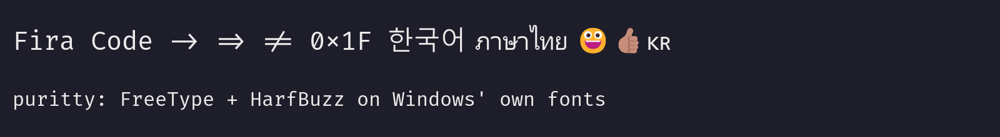
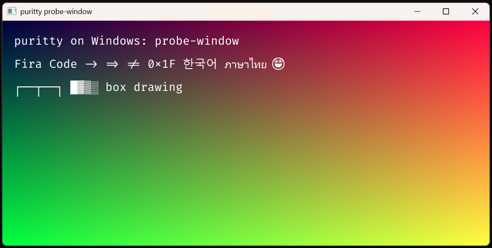

# puritty on Windows: a survey (2026-11-09)

Gilbert, 2026-11-09: puritty on Windows, cross-built from Linux, before the
compiler runs there (geng-lang `docs/open-items.md` D1062–D1065, "Windows:
puritty, the compiler, the work"). His Windows 11 machine, `beelink1`, takes
ssh from nene, so this survey was measured there by Claude without him: files
copied with `scp`, programs run over ssh, window programs started in his
desktop session through a scheduled task and seen in a screenshot
(`harness/windows/`).

Geng's Windows target is done through geng-lang `m4-windows.md` §WN11 step
5: a Geng program built with `--platform=windows` runs there, with all of
`os`, a pseudo console (ConPTY) for a child on a terminal, and a console read
and written in UTF-16. What puritty adds is its window: everything
`packages/x11` does. This survey says what that is, what Windows offers for
each part, what was measured, and proposes the order.

## WS1 · What puritty asks of its platform

`packages/x11` is a Geng module of 450 lines over 2,306 lines of C. The
Geng side is small and portable; the C does five things:

| part | on X11 | what of it is X11's |
|---|---|---|
| the window | an X window, a retained pixmap the size of the cells, rows copied to the window, a scroll as one copy | the window and the copies |
| text | runs shaped by HarfBuzz, glyphs rasterised by FreeType, colour glyphs as ARGB, a fallback face found by fontconfig, uploaded to the server with XRender | XRender's glyph set and composites; fontconfig |
| box drawing | lines and blocks drawn by the C into a canvas | nothing |
| ink | which cell edges a glyph's pixels crossed (V40) | nothing |
| events | keys through XKB (V47), an IME through XIM (V46), the pointer, the size, the focus, the close, selections and paste | all of it |

The app (`app/src`, 2,326 lines) adds three Linux assumptions of its own:
the settings file under `XDG_CONFIG_HOME` or `~/.config`, the program run as
`$SHELL` or `/bin/sh`, and `X11.` in about thirty places in `Main`. The
terminal core (`vt`, 27,148 lines) assumes nothing of the platform: it reads
bytes, keys as records, and answers a display list.

## WS2 · Measured on beelink1

Windows 11 25H2 (build 26200), PowerShell 5.1 over ssh.

| what | measured |
|---|---|
| display | one monitor, 3840×2160, scaled 150% (144 DPI); a window that declares per-monitor DPI awareness (v2) gets the real pixels |
| input languages | Korean (Microsoft IME), English (US, and US-International), Thai |
| IMM32 | a window gets an input context, and the active layout is an IME (`ImmIsIME`) |
| a key's text | `ToUnicodeEx`, asked not to change the keyboard's state (flag 4), gives each layout's character for a key, unshifted and shifted: the Korean layout's are Latin (its Hangul comes through the IME), Thai's are Thai, and US-International's ` key is a dead key (−1) |
| fonts | Fira Code, installed for the user only (`%LOCALAPPDATA%\Microsoft\Windows\Fonts`), Cascadia Code and Mono, Consolas, DejaVu and Liberation Mono; Malgun Gothic, Gulim, Batang for Hangul; Leelawadee UI for Thai; Segoe UI Emoji |
| clipboard | readable; `CF_UNICODETEXT` there |
| a frame's copy | a 32-bit bitmap the window's size (1178×544) copied to the window with `BitBlt`: 0.39 ms, the median of 60 |
| a window's first paint | 35 ms after it is made |
| ssh | Windows' OpenSSH client is installed (`C:\Windows\System32\OpenSSH\ssh.exe`) |

**FreeType and HarfBuzz on Windows' own fonts** (`bench/windows/probe-text.c`):
FreeType 2.14.3 and HarfBuzz 13.2.1, the versions nixpkgs pins, shape and
rasterise one line in four faces as puritty's renderer does, picture below
the table. Fira Code's ligatures (`->`, `=>`, `!=`, `0x`), Hangul in Malgun
Gothic, Thai in Leelawadee UI, and Segoe UI Emoji's colour glyphs, which
FreeType draws from the font's colour table as BGRA: 😀 and the
skin-toned 👍🏽 as one glyph. 🇰🇷 is the letters "KR", since Segoe UI Emoji has
no flags; that is Windows' font, the same in every program. Shaping took
0.05 to 0.3 ms a run; Malgun Gothic's first glyphs 13 ms, its 13 MB loaded.

**GDI, for comparison** (`bench/windows/probe-window.c`): Windows' own text
drawing found Fira Code, applied its ligatures, and fell back to Hangul, Thai
and emoji by itself; its emoji is monochrome, since GDI draws no colour
glyphs, and Fira Code's box-drawing glyphs do not join (puritty draws those
itself anyway). The window as Gilbert's screen showed it (below):

**A console program opens a console.** The window probe, linked as a console
program, made Windows Terminal open a tab for it behind its window. puritty
has to be linked for the GUI subsystem (`-mwindows`). Geng's runtime, with no
console, answers a write to standard output with an error
(`ERROR_INVALID_HANDLE`), not a crash.

## WS3 · Drawing: puritty's own text path, into memory

**Proposed: keep FreeType and HarfBuzz, and draw into a bitmap.** The X11 C
uploads glyphs to the server and composites them with XRender. On Windows
the same code draws into a 32-bit DIB section the size of the cells, the
retained pixmap's twin, and the rows a frame touched are copied to the window
with `BitBlt`, which measured 0.4 ms for a whole window. Shaping, the face
lookup, rasterising, colour glyphs, box drawing and ink are the X11 C's as
they are; only the glyph set and the composite become a blend into memory.

Against **Direct2D and DirectWrite**: they are COM interfaces, written for
C++, with ClearType and Windows' own font fallback. They would be a second
text path, rendering differently from Linux, so the pixel gate (V38) could not
hold the two to one picture, and the ink measurement would be done again.
Against **GDI**: no colour emoji, and its own fallback.

What changes:

- **Finding a face.** fontconfig is Linux's. On Windows the faces are files
  in `C:\Windows\Fonts` and the user's font folder, named in the registry
  (`HKLM` and `HKCU` `...\CurrentVersion\Fonts`). The primary font is found
  by its family name there; a fallback is chosen by script from a short list
  (Malgun Gothic for Hangul, Yu Gothic or MS Gothic for Japanese, Microsoft
  YaHei for Chinese, Leelawadee UI for Thai, Segoe UI Emoji, Segoe UI
  Symbol), each checked for the cluster with the coverage test the X11 C has
  (`covers`). Only the Korean, Thai and emoji faces were looked for on
  beelink1; the Japanese and Chinese ones are Windows' defaults where their
  language packs are installed. DirectWrite's `IDWriteFontFallback` is the alternative if the
  list proves short.
- **Building the two libraries.** HarfBuzz builds for Windows as its one
  source file (`src/harfbuzz.cc`) with the toolchain's `g++`, with threads
  off (`HB_NO_MT`; puritty shapes on one thread), in 22 s; nixpkgs' own
  build needs a Windows Python that nixpkgs marks broken. nixpkgs' FreeType
  builds, but needs libpng, bzip2 and Brotli as DLLs; libpng serves only
  bitmap emoji fonts, which Windows' is not, so a FreeType built from source
  with zlib alone keeps puritty one static `.exe`, as Geng's Windows
  programs are (D1073). A script beside `packages/x11/build-imdkit.sh`
  would build both and give `pkg-config` their flags (D890).

## WS4 · The window and Geng's loop

A Win32 window belongs to the thread that made it, which has to keep taking
its messages. Geng's loop on Windows waits on an I/O completion port (D1075),
not on window messages. The runtime already has the way across: a *post*
(`geng_post`, D897), by which a thread that holds no Geng value hands
messages to the program's thread.

**Proposed:** a window thread, started by `open`, makes the window and runs
its message loop. It turns messages into the same event records X11's C
makes (V36) and queues them; the first queued after a `take` sends a post,
which answers `events`. `draw` copies the display list and hands it to the
window thread (`PostThreadMessage`), which draws it into the bitmap,
invalidates the rows, and posts the ink back. The Geng side, `events`,
`take` and `draw`, is unchanged, and so is everything in `vt` and most of
`Main`. FreeType and HarfBuzz run on the window thread alone, so HarfBuzz's
threads stay off.

## WS5 · Keys

The record a key makes stays X11's (V47): an action, a key code, the
modifiers as Ghostty's bits, the modifiers its text consumed, its unshifted
code point, its keysym and its text. On Windows:

- the key code is the scan code (`lParam` bits 16–23 and the extended bit);
- the keysym is X11's for the same key: the C maps each virtual key that
  makes no text (arrows, F1–F24, the keypad, Home, Insert, …) to the keysym
  X11 gives it, so `vt`'s encoder (Ghostty's, `docs/phase3-input.md` §4)
  reads Windows' keys as Linux's;
- the text is `WM_CHAR`'s, after `TranslateMessage`, so a dead key
  (US-International's `` ` ``) composes as Windows composes it;
- the unshifted code point is `ToUnicodeEx` of the key with no modifiers,
  asked not to change the keyboard's state (flag 4, measured: the Korean
  layout gives Latin, Thai gives Thai);
- left and right modifiers from `GetKeyState` of `VK_LSHIFT` and the rest;
  Alt arrives as `WM_SYSKEYDOWN`, which must not reach `DefWindowProc` for
  keys puritty uses (Alt+letter to the program, not to a menu).

## WS6 · The IME

**IMM32**, the older of Windows' two input-method interfaces and the one
the Korean IME serves to every program that asks: `WM_IME_COMPOSITION` with
`GCS_COMPSTR` (the preedit, its caret `GCS_CURSORPOS` and its attributes
`GCS_COMPATTR`) and `GCS_RESULTSTR` (the commit), `WM_IME_ENDCOMPOSITION`
(done). These are X11's records 5, 6 and 7 as they are; puritty draws the
preedit itself, as it does on X11 (V46), and `spot` becomes
`ImmSetCompositionWindow` and `ImmSetCandidateWindow` at the cursor's cell.
**TSF**, the newer, is COM, and is what Windows Terminal uses; it can wait
until IMM32 is found short.

## WS7 · The rest of the window

| X11 | Windows |
|---|---|
| size in cells | `WM_SIZE`, divided by the cell |
| focus | `WM_SETFOCUS`, `WM_KILLFOCUS` |
| close | `WM_CLOSE` |
| the pointer, the wheel | `WM_MOUSEMOVE`, the button messages, `WM_MOUSEWHEEL` (120 a notch, finer on a touchpad: steps accumulated) |
| every motion, or only with a button | the same messages, filtered |
| I-beam and arrow | `SetCursor` in `WM_SETCURSOR`, `IDC_IBEAM` and `IDC_ARROW` |
| title | `SetWindowTextW` |
| DPI | new on Windows: the window declares per-monitor awareness (v2) and takes `WM_DPICHANGED` when moved to another monitor or rescaled, as a zoom (V50) |
| the pixel gate's picture | the bitmap written as the same PPM |

## WS8 · Selections

X11 has two selections, PRIMARY (copy on select, paste with the middle
button) and CLIPBOARD. Windows has the clipboard alone (`CF_UNICODETEXT`,
UTF-16). `X11.Selection`'s `Primary` has no Windows twin: puritty can keep
its own selection as PRIMARY within its windows, so a middle click pastes
what was last selected in puritty, or leave PRIMARY out on Windows. OSC 52
writes the clipboard either way (§16).

## WS9 · The shell, ssh and settings

- **The program run.** `$SHELL` or `/bin/sh` on Linux; on Windows
  `%COMSPEC%` (cmd.exe) unless PowerShell is wanted (`pwsh.exe`, then
  `powershell.exe`). It runs on a pseudo console, which `Os.Process`
  already gives a child (D1088).
- **ssh.** Windows' own `ssh.exe` runs on the pseudo console like any
  program, so `puritty ssh host` works before an ssh client is built in
  (D1062's plan). A built-in client, with its cryptography, is its own
  survey.
- **Settings.** `%APPDATA%\puritty\config.toml` for
  `$XDG_CONFIG_HOME/puritty/config.toml`.

## WS10 · One application, two platforms

A Windows build refuses a package declared for Linux (D1083), and Geng has no
dependencies by platform, so puritty's one `app/geng.toml`, which lists
`x11`, cannot build for Windows. **Proposed:** the platform package's module
is named for what it is, `Window`, in both packages (`x11` renamed from
`X11`, and a new `packages/win32`, `platform = "windows"`), with the same
functions and types; and the application has two manifests,
`app/linux/geng.toml` and `app/windows/geng.toml`, over the one `app/src`,
each listing its platform's package. `app/src` imports `Window` and does not
know which. The settings path and the default program, the only other
differences, come from `Os.Env` and are tested at run time. A Geng feature
for dependencies by platform (`[dependencies.windows]`) would make the two
manifests one, and can wait until a second program needs it.

## WS11 · What can be tested from here

Without Gilbert: building, copying and running anything; a window in his
session and its screenshot; the clipboard, set and read by PowerShell; and
keys and the IME through `SendInput` from a program in his session.

**Measured** (`bench/windows/probe-ime.c`): keys sent with `SendInput` reach
the Korean IME as typed keys do. The 한/영 key (`VK_HANGUL`) turns Hangul on;
then `g`, `k`, `s` arrive as `VK_PROCESSKEY` (0xE5) with the preedit ㅎ
(U+314E), 하 (U+D558), 한 (U+D55C) in `WM_IME_COMPOSITION`'s `GCS_COMPSTR`,
and a space commits 한 (`GCS_RESULTSTR`, then `WM_CHAR` U+D55C) and is
typed. Setting Hangul mode with `ImmSetConversionStatus` alone did not
compose: the keys arrived as Latin letters. A program started by the task
scheduler cannot take the foreground by asking; joining the foreground
thread's input for the moment it raises its window (`AttachThreadInput`)
lets it, and sends that thread nothing. The probe sends a key only while
its own window is the foreground, and stops otherwise, so that nothing it
types reaches another program.

With Gilbert: typing Hangul into puritty by hand once, as a check of what
`SendInput` showed; how it feels; the scaled display at 150% and a move to
another monitor, if he has one.

## WS12 · The steps, in order

1. **The toolchain.** FreeType (zlib only) and HarfBuzz built for Windows as
   static libraries, with their `pkg-config` files, by a script.
2. **`Window`.** `X11` renamed `Window`; `app/linux/` and `app/windows/`
   manifests; the Linux build unchanged, every gate passing.
3. **`packages/win32`, drawing.** The window thread, the bitmap, the X11
   C's text, box and ink code moved where both packages share it, and
   `draw` and `shot`. A frame of `vt`'s output on beelink1, compared with
   Linux's picture of the same frame.
4. **Events.** Size, focus, close, the pointer, keys (WS5), then the IME
   (WS6), each with a `SendInput` probe.
5. **The app on Windows.** The program run on a pseudo console, the
   settings path, the clipboard; `puritty` running cmd, PowerShell and
   `ssh` on beelink1.
6. **The pixel gate and the replay corpus on Windows**, run over ssh.

## WS13 · Questions for Gilbert, with leanings

1. **Drawing** (WS3): FreeType and HarfBuzz into a bitmap, the same pixels as
   Linux, or Direct2D and DirectWrite, Windows' own look. *Leaning: FreeType
   and HarfBuzz.*
2. **PRIMARY on Windows** (WS8): kept within puritty (a middle click pastes
   puritty's last selection), or left out. *Leaning: kept within puritty.*
3. **The default program** (WS9): cmd, Windows PowerShell, or PowerShell 7
   when installed. *Leaning: PowerShell 7 if installed, else Windows
   PowerShell; cmd when neither.*
4. **One app, two manifests** (WS10), or a Geng feature for dependencies by
   platform first. *Leaning: two manifests now.*
5. **The IME** (WS6): IMM32 first, TSF when needed. *Leaning: IMM32.*
6. **Windows' own libraries in a package** (WS15): a `[native]` key that
   names system libraries, or a `.pc` file the package carries. *Leaning:
   the key; a `.pc` file for libraries that are not packages is a work-around.*
7. **The GUI subsystem** (WS15): a key in the application's manifest
   (`[native] subsystem = "gui"`), or a `geng make` flag. *Leaning: the
   manifest, since it is a property of the program, not of one build.*

## WS14 · Step 1 built: the text libraries for Windows (2026-11-09)

`packages/win32/build-text-libs.sh` builds FreeType 2.14.3 and HarfBuzz
13.2.1 for Windows, static, from the sources geng-lang's nixpkgs pin has,
into `vendor/win-text` with `pkg-config` files, in 27 s:

- FreeType's core, its bitmap, glyph, emboldening, box and variation
  calls, and the modules OpenType and TrueType faces need (TrueType, CFF,
  SFNT with its colour tables, the auto-hinter, the smooth renderer), with
  FreeType's own copy of zlib: no libpng, bzip2 or Brotli.
- HarfBuzz's one source file, compiled by the toolchain's `g++` with
  threads off; its object needs nothing but the C library and libgcc, so a
  Geng program's C link takes it.

`bench/windows/probe-text.c` linked against them by `clang` alone, as a Geng
build links (`-static`), is one 2.2 MB `.exe` that needs no DLL but
Windows' own, and on beelink1 drew the picture above byte for byte as the
build against nixpkgs' FreeType DLLs did.

Note for a Windows build: the toolchain's `pkg-config` wrapper reads
`PKG_CONFIG_PATH`, not its target-suffixed variable, when run outside a
Nix build, so a build sets both, as geng-lang's `run.py` does.

## WS15 · The window thread and Geng's loop, proved (2026-11-09)

`bench/windows/geng-window` is a Geng program, built with `geng make
--platform=windows`, whose own C (`src/Ext/windows/`) does what WS4
proposes: `open` opens a post and starts a window thread; the thread makes
a window, runs its message loop and queues a line for each message under a
lock, sending the post a message each time; `events` answers at once when
the queue holds something and otherwise keeps its wait for the post's
`ready`, which runs on the program's thread; `take` answers the queue.

On beelink1, over ssh and in Gilbert's desktop session alike, Geng's loop
was woken for each event as it came: the window made (on a thread of its
own), focus in, its size, its close, each a batch of its own, and the
program ended at the close with status 0. The thread holds no Geng value;
the wait is kept in an object allocated old (`geng_alloc_old`), which never
moves, so the C's static and the post's `ready` see one address, and the
post keeps it alive.

Two things a Windows build of puritty needs that Geng's build does not have:

- **Windows' own libraries.** The window's C calls `gdi32`, `user32` and
  `imm32`; a package's `[native]` table names `pkg-config` modules (D890),
  and these have none. The probe passes them in `GENG_LDFLAGS`. A package
  needs a way to name them: a `.pc` file of its own with only `Libs:
  -lgdi32 -luser32 -limm32`, or a `[native]` key for system libraries.
- **The GUI subsystem.** A program for the console subsystem gets a console
  window when started from the desktop (WS2). `-mwindows` at the link makes
  it a GUI program; Geng's build has no switch for it, and `GENG_LDFLAGS`
  would carry it for every program built in that shell. A `[native]` key,
  or one in the application's manifest, is the likelier home.

## WS16 · Gilbert's answers (2026-11-09)

All seven leanings taken.

- **V52 · Windows draws with FreeType and HarfBuzz into a bitmap** (WS3):
  the X11 C's text, box drawing and ink, shared by both platforms, the
  same pixels as Linux.
- **V53 · PRIMARY is kept within puritty on Windows** (WS8): a selection
  made is puritty's PRIMARY, and a middle click pastes it; the clipboard
  is Windows'.
- **V54 · The program run on Windows** (WS9): PowerShell 7 (`pwsh.exe`) when
  installed, else Windows PowerShell, else `%COMSPEC%`; the settings can
  name any other.
- **V55 · One application, two manifests** (WS10): `app/linux` and
  `app/windows` over one `app/src`; both platform packages give a module
  `Window`.
- **V56 · The IME on Windows is IMM32** (WS6); TSF if IMM32 falls short.
- **Questions 6 and 7 are Geng's**: a `[native]` key for system libraries
  and one for the GUI subsystem (geng-lang Dnene36, Dnene37).

## WS17 · Step 2 built: `Window`, and the application's Linux manifest (2026-11-09)

V55, the first half. `packages/x11`'s module is `Window` (`X11.geng` moved
to `Window.geng`), and the package says it is Linux's (`runtime = "linux"`,
D1074), so a Windows build refuses it by name. The application's manifest
is `app/linux/geng.toml`, its source `["../src"]`, with its lock beside it;
`app/build.sh` builds from there into `app/puritty` as before, so every
harness that runs `app/puritty` is unchanged. `app/src`, the pixel harness
and the X11 probe import `Window`. `app/windows/geng.toml` comes with
`packages/win32` (step 3).

The package saying `linux` found a Geng defect: `Compiler.Runtime.toPlatform`
had no case for the platforms under `os`, so a package declared for Linux
reached the compiler's backend as an unknown platform and every build of
puritty failed to decode it. geng-lang fixed it (its `m4-windows.md` §WN26)
with a case for each in its corpus.

Puritty built from `app/linux`, the pixel gate (36 of 36) and the unit
tests (68) pass.

## WS18 · Step 3 built: `packages/text`, `packages/win32`, and the pixel gate on Windows (2026-11-10)

V52, built. **The pixel gate's 36 cases draw on Windows exactly as on
Linux**: `harness/pixels.py --windows beelink1` draws every case with
`packages/win32` on beelink1 and holds its picture to the Linux pin, and all
36 are the same, pixel for pixel.

**`packages/text`** (`puritty-text`) is the X11 C's drawing, moved: the
display list's decoding, the faces, HarfBuzz's shaping, FreeType's
rasterising, colour glyphs, box drawing and ink. Its header
(`src/Ext/include/puritty_text.h`) says what it gives a platform (`pt_open`,
`pt_frame`, `pt_zoom`, the ink) and what a platform gives it: a fill, a
glyph kept under an id, the placed glyphs drawn, a colour picture, a target
of so many cells, a scroll, and the file of a font or a fallback face. Its C
reaches the platforms' C through a Geng feature made for it: a package's
`src/Ext/include` is on every C file's include path (geng-lang Dnene38).
`packages/x11` keeps the window, the events and the selections, and draws
the renderer's calls with XRender as it did: the Linux gate passed 36 of 36
with the drawing moved.

**`packages/win32`** draws into memory. The target is a bitmap of 32-bit
pixels the size of the cells; a fill sets pixels, a scroll moves rows, and
a glyph is blended in its colour with pixman's arithmetic for OVER through
an A8 mask, so that it is XRender's pixel; a colour glyph is premultiplied
ARGB drawn OVER. The window's `WM_PAINT` copies the bitmap with
`SetDIBitsToDevice` and fills the margins. Fonts are found by family among
the files the registry names (`HKLM`, `HKCU`), or among the files of the
directories `PURITTY_FONT_DIRS` names; each face of a collection and each
named instance of a variable font is a face to choose, and a variant the
family lacks is the closest one (bold italic is the bold, italic the
regular, which the renderer slants). A fallback face comes from a list of
families tried in order, `tag:Family` first when the language is `tag`
(`PURITTY_FALLBACK`, else Windows' own: Cascadia Mono, Consolas, Malgun
Gothic, Yu Gothic, Microsoft YaHei, Leelawadee UI, Nirmala UI, Segoe UI
Emoji and more), and Hangul is asked for in Korean, as fontconfig's
language coverage does.

**Where the build departs from WS4.** The frame is drawn on the program's
thread, not handed to the window thread: drawing into memory needs no
window, so `draw` answers its ink at once as X11's does, FreeType and
HarfBuzz still run on one thread, and the window thread only paints, under
a lock the draw holds too. Events are queued as WS4 says; this step has
the size, the focus and a request to close, and the rows step 4 fills
(`setPointer`, `motion`, `spot`, `select`, `paste`) change nothing yet.

**The gate on Windows.** The window draws from memory, so the ssh session
serves and no desktop is needed. `harness/pixels/build-windows.sh` builds
`core-pixels.exe` (a console program, so its exit and stderr reach ssh);
`pixels.py --windows` copies it, the cases and the gate's font files, runs
them all in one `harness/pixels/run.ps1`, and brings the pictures back.
`PURITTY_FALLBACK` there is fontconfig's order on those fonts: DejaVu Sans
Mono, the language's Noto Sans Mono CJK, DejaVu Sans, Noto Sans Mono CJK
JP, Noto Color Emoji, Noto Sans Thai, Noto Sans Devanagari. Every case
chose the same files and indexes as on Linux. Windows will not make a window
as narrow as the five smallest cases' screens (90 pixels; its least is 137),
so a picture larger than its pin is held to it cut to the pin's size.

**What the comparison found**, in the order it was found:

- *HarfBuzz's assertions.* Windows' HarfBuzz is built with them, and the
  first frame stopped: `hb_buffer_add` asks for the buffer's content type to
  be set first, which the renderer never did. Linux's HarfBuzz has no
  assertions and shaped anyway. The renderer sets it.
- *FreeType's autohinter and HarfBuzz.* 18 of 36 matched at first. Fira
  Code's ligatures, Thai and Devanagari differed in the glyphs a font
  reaches only through its substitutions. nixpkgs' FreeType on Linux loads
  HarfBuzz at run time, and its autohinter uses it to give those glyphs
  their script's style; the Windows build did not. It is built with
  `FT_CONFIG_OPTION_USE_HARFBUZZ` now, linked to the static HarfBuzz. 33 of
  36, with the window-width cut.
- *A variant's closest face.* The Windows finder gave a family with no bold
  italic its regular for bold italic, where fontconfig gives the bold; the
  renderer then took the regular face for italic of itself and drew Fira
  Code's italic upright. 35 of 36.
- *PNG glyphs.* Noto Color Emoji's glyphs are PNG (CBDT), and the Windows
  FreeType had no libpng (WS3 left it out, since Windows' own emoji font is
  COLR). It is built with a static libpng and zlib now
  (`packages/win32/build-text-libs.sh`), so a user's bitmap emoji font draws
  too, and puritty is still one `.exe`. 36 of 36.

**A colour face may be COLR.** The renderer took only a face of bitmap
strikes for a colour face, so Windows' Segoe UI Emoji, colour layers over
outlines, would have drawn emoji in one colour. A scalable face with colour
is a colour face now, sized to the cell's height and reduced into the
cluster's box as a strike is; FreeType draws its layers into a BGRA bitmap
(measured in WS2's text probe). The Linux gate has no such face and is
unchanged.

**On the screen.** `core-pixels.exe` run in Gilbert's desktop session with
`PURITTY_LINGER` (the window kept up after the shot) showed the `mixed`
case in its window at 150%: kana, Han from Noto Sans Mono CJK, the
highlight and the cursor, painted by `WM_PAINT`.

**The application** has its Windows manifest, `app/windows/geng.toml`
(`subsystem = "gui"`, `packages/win32`), and `app/build-windows.sh` builds
`app/puritty.exe`. Started on beelink1, it opens its window and ends:
`spawn /bin/sh: The system cannot find the file specified`, the Linux
default program, which V54 replaces in step 5.

## WS19 · Step 4 built: keys, the pointer and the IME, and the events gate (2026-11-10)

WS5, WS6 and WS7, built in `packages/win32`. **Every record is X11's, read
so that Windows' keys and pointer reach Geng as Linux's do**, and
`app/src` takes them unchanged.

**Keys.** The window thread takes a key message from its loop before it is
dispatched. Its code is X's keycode for the same key: the scan code (and
Windows' extended bit) through a table generated from Ghostty's
`keycodes.zig` (`packages/win32/gen-keycodes.py`, 155 keys), so
`Keys.encode`'s `evdevKey (keycode - 8)` reads it as it reads Linux's. Its
keysym is X's: a table for the keys X names by their function (Return,
Tab and `ISO_Left_Tab` with Shift, the arrows, F1–F24, the modifiers, the
keypad's `KP_` keysyms, told from the keys between by the extended bit),
the character's own for the rest, and a dead key's `dead_` keysym. Its
text follows X's too: a table key's is what xkbcommon gives its keysym
(Return `\r`, Delete `\x7f`, the keypad's characters, nothing for
Shift+Tab); another key's is its character at its level (Shift, Caps Lock,
AltGr) when Ctrl or Alt is held, as X's keysym ignores them (Ctrl+C is
`c`), and otherwise what `WM_CHAR` made of it, so a dead key composes as
Windows composes it (`` ` `` then `a` is `à`, `` ` `` then `b` is
`` `b ``). Its modifiers are the state before the key, as X's event
carries them: Shift's own press says no Shift, its release says Shift.
**AltGr** is the right Alt on a layout that has it; Windows sends a left
Ctrl with it, at its time, which is no key and not Ctrl, so AltGr+Q on
US-International is `ä` with no modifier, as X's `ISO_Level3_Shift` is
none of Ghostty's. Shift and Caps Lock are consumed when they change the
key's text (asked of the layout with `ToUnicodeEx`'s flag 4, which leaves a
waiting dead key waiting), Shift and Num Lock always on the keypad, as
XKB's key types consume them. A key the IME takes
(`VK_PROCESSKEY`) is the IME's, and a release whose press was not recorded
is not recorded. A character typed as itself (`VK_PACKET`, as the emoji
panel types) is a press with code 0 and its text, the two halves of one
outside the BMP joined. Alt+F4 and Alt+Space are Windows' (close, the
window's menu); every other Alt key is the program's, and the menu bar
never takes the keyboard.

**The pointer.** X's buttons (left 1, right 2, middle 3, the side
buttons 8 and 9), the window capturing the pointer while one is held, so a
drag past the edge goes on with negative or larger positions. A wheel step
is 120 of its delta, smaller deltas summed and a turn the other way
starting the sum again; up 4, down 5, left 6, right 7. A motion is
recorded only while a button is held, unless `motion` asks for all of
them; one where the pointer did not move (Windows sends them as a window
opens under it, or with a button) is not; and a motion not yet taken is
replaced by the next, as X11's are. The I-beam and the arrow are set at
once when `setPointer` changes them.

**The IME** is IMM32 (V56). The window says the IME's composition window
is not to be shown and answers `WM_IME_STARTCOMPOSITION` itself, so the
preedit is puritty's to draw; each composition string replaces the whole
preedit (first 0, the old length), with its caret and its attributes as
feedback (the clause being converted reversed, 1; the rest underlined, 2);
a result string is a commit; a commit that leaves nothing composing, or a
composition ended, records an empty preedit and then done. `ImeReady` is
recorded as the window opens: every window has an input context. `spot`
is sent to the window thread, which owns the context, and places the
composition window at the cell and the candidates below it
(`CFS_EXCLUDE`, the cell left uncovered): measured, the Hanja candidates
opened 27 pixels in and 57 down from the client's corner, the bottom-left
of cell (3, 2) at 9×19 cells.

**The events gate**, `harness/events.py`. `harness/events/core-events.exe`
opens `Window` and writes every event it takes as a line;
`harness/events/drive.exe` finds its window, makes it the foreground, puts
the pointer off it and types F24, which marks where the case begins, and
does the case's actions with `SendInput`: keys with their scan codes,
characters, the pointer moved and its buttons and wheel, the keyboard
layout (each case begins on US; Korean and US-International are Gilbert's
own), a check of the pointer's shape, and a picture of the screen around
the window. It sends an input only while the window has the foreground,
and a press only while the pointer is over it; otherwise it stops, and
every key it pressed is released whatever happens. `harness/events/run.ps1`
runs every case in Gilbert's desktop session (`harness/windows/`), and the
logs come back to be held to `corpus/events/NAME.txt`. 13 cases: keys
(the basic keys, Ctrl and Alt and the sides and puritty's own keys and a
repeat, the keypad, dead keys and AltGr, characters typed as themselves),
the pointer (each button, a drag past the edge, the wheel's steps, Shift
and Ctrl, every motion, the two shapes), and the Korean IME (the Linux IME
gate's five Hangul cases, and Hanja chosen from the candidates). All 13
pass, and passed five runs in a row.

**What differs from Linux**, measured:

- *The Korean IME's preedit.* Windows' gives the caret before the
  syllable being composed (0) and its attribute as input (underlined, 2);
  ibus and fcitx5 give the caret after it (1) and reversed (1). puritty
  draws its cursor at the caret, so on Windows the cursor sits on the
  syllable, which is how Windows' own programs show a Korean composition.
  The records keep what each IME says.
- *Hanja.* Windows' Korean IME sends no preedit while a candidate is being
  chosen, only the commit of the one chosen.
- *A focus change commits.* The composition is committed when the window
  loses the focus (seen when a screenshot's task took it), as the IME
  does it.
- *The keypad.* `SendInput` of `VK_NUMPAD1` is `KP_1` and `1` whatever Num
  Lock says, where a keyboard with Num Lock off sends `KP_End`; the pins
  were taken with Caps Lock and Num Lock off on beelink1, and the driver
  refuses to run a case with either on, since it would change their
  modifiers.
- *XKB's key types* are not on Windows; `consumed` comes from asking the
  layout. What it gives was compared with the types read from the X
  keymap, not with X11's records: letters consume Shift and Caps Lock,
  digits and punctuation Shift, the space nothing, the keypad Shift and Num
  Lock, and Tab Shift (a table entry: Shift does not change Tab's text on
  Windows). The events gate is Windows' alone; running its cases on Xvfb
  with xdotool would hold the two to each other.

**By hand, with Gilbert:** typing Hangul into puritty with a keyboard, as
a check of what `SendInput` showed; how the preedit looks, once the app
runs (step 5); the pointer's shape and the wheel on a touchpad.

## WS20 · Step 5 built: puritty on Windows (2026-11-10)

`app/puritty.exe` runs on beelink1: a shell on a pseudo console, its
settings, and both selections. Seen in Gilbert's desktop session through
`harness/events/app.ps1`, which starts it, types into it with `drive.exe
--any` (its window by its class, whatever title the program gives it), and
takes pictures with the driver's `shot`.

**`Platform`.** What differs other than the window is one module beside
each manifest, `app/linux/src/Platform.geng` and
`app/windows/src/Platform.geng` (both manifests now read `["../src",
"src"]`), with the same two functions, so `app/src` does not ask which
platform it is on:

- `settingsDirectory`: `$XDG_CONFIG_HOME/puritty` or `~/.config/puritty`
  on Linux, `%APPDATA%\puritty` on Windows (WS9). Measured: a
  `config.toml` there gave a 50-column window, its background and its
  `[program] command`.
- `programs`: the programs run when the settings and the command line name
  none, tried in order until one is found (V54): `$SHELL` or `/bin/sh` on
  Linux; `pwsh.exe`, `powershell.exe`, then `%ComSpec%` on Windows, whose
  environment variables are looked for in any case (`ComSpec`). beelink1
  has no PowerShell 7, and puritty ran Windows PowerShell 5.1, its colours
  and a Hangul `echo` as they should be. `cmd.exe` given on the command
  line ran, and Windows' `ssh` asked its host-key question through the
  pseudo console and took the answer.

**The selections** (V53), in `packages/win32`: Ctrl+Shift+C makes the
window the clipboard's owner with the text as UTF-16, LF written as CRLF as
Windows' programs end lines; Ctrl+Shift+V reads the clipboard, CRLF read as
LF as Linux's text is; another program's copy is a `SelectionLost
Clipboard`, by `WM_CLIPBOARDUPDATE`. PRIMARY is puritty's own: a selection
is kept in the process, and a middle click or Shift+Insert pastes it. A
paste is answered at once, but as X11's is (a `Pasted` event, then
`pasted`), so `Main` is unchanged. Measured: `hello` double-clicked and
copied was what `Get-Clipboard` printed; `Set-Clipboard -Value 'from
windows'` then Ctrl+Shift+V pasted it; a middle click pasted `hello`.

**Linux is unchanged:** the pointer gate (51 of 51) and the IME gate (14
of 14) pass with the app built from `app/linux`, and on Windows the events
gate (13 of 13) and the pixel gate (36 of 36).

**Left open:**

- *The default font.* `DejaVu Sans Mono` is not a Windows font, so the
  stand-in, Cascadia Mono, is drawn; a Windows default in `Platform` is a
  choice for Gilbert.
- *The language and the charset* come from `LANG` and `LC_*`, which
  Windows does not set, so fallback fonts are asked for in no language and
  the charset is UTF-8; Windows' own locale (`GetUserDefaultLocaleName`)
  would say Korean on beelink1.
- *An ssh session* to another machine, and Hangul typed by hand in the app,
  are Gilbert's to try.
- Step 6, the replay corpus on Windows over ssh, is what WS12 has left; the
  pixel gate already runs there (WS18).

## WS21 · The default font and the language from Windows (2026-11-10)

Gilbert's answers to WS20's two open choices: Windows has a default font of
its own, and the language is asked of Windows rather than read from
`LANG`.

**The font.** `Platform.font`, beside each manifest, is the family drawn
when the settings name none, and `Config.defaults` takes it: `DejaVu Sans
Mono` on Linux, as before, and `Cascadia Mono` on Windows, Windows
Terminal's own, which Windows 11 has. Where it is missing (Windows 10 before
Windows Terminal), `packages/win32`'s stand-ins, Consolas then Courier New,
are drawn, as they were for any family Windows lacks. Seen on beelink1:
puritty opened with no settings file and drew PowerShell in Cascadia Mono.

**The locale.** `Platform.locale` answers the language fallback fonts are
asked for (V25) and the charset of a local program's bytes, and `Main`
takes both from it when the settings name neither. On Linux it is what
`Config` did, moved: `LC_ALL`, `LC_CTYPE`, `LANG`. On Windows it is a new
module of `packages/win32`, `Locale.language` (not in `Window`, which
stays X11's twin, V55).

*Which Windows setting.* The first try read the regional format
(`GetUserDefaultLocaleName`), and beelink1 answered `en-US`, though
Gilbert set it up for Korean and sees Notepad's menus in Korean. Read from
his desktop session, beelink1 keeps three settings apart:

| setting | beelink1 | read by |
|---|---|---|
| language list (Settings, Language & region) | `ko`, `en-US`, `th`; Korean IME on `ko` | packaged programs (Notepad) |
| display language | `en-US` (`WindowsOverride`) | Windows itself, older programs |
| regional format, system locale | `en-US`; ANSI code page 1252 | `GetUserDefaultLocaleName`, `GetACP` |

Which forms of Han a fallback font draws is a question about the
language the user reads, which is the list's, not about dates and numbers,
which is the regional format's. `Locale.language` answers the head of the
list, `HKCU\Control Panel\International\User Profile\Languages` (the list
Settings writes; the documented reader is WinRT's
`GlobalizationPreferences.Languages`, which a C program reaches only through
COM), and the regional format only when the list is missing. The display
language override is not read: `GetUserPreferredUILanguages` answers it,
and on beelink1 that is `en-US`. `packages/win32` now links `advapi32`
for the registry. Measured on beelink1 by a probe printing what `Platform`
answers: `ko`, charset `utf-8`, font `Cascadia Mono`.

The name becomes fontconfig's language as `cjk-and-thai.md` names them,
checked over these names: `ko-KR` → `ko`, `ja-JP` → `ja`, `zh-CN`,
`zh-Hans`, `zh` → `zh-cn`, `zh-TW`, `zh-Hant`, `zh-Hant-TW` → `zh-tw`,
`zh-HK` → `zh-hk`, `zh-SG` → `zh-sg`, `sr-Latn-RS` → `sr`, `haw-US` →
`haw`, `en-US` → `en`; the invariant `x-IV` and an empty name → none.

*The charset* is UTF-8 on Windows whatever the locale: the pseudo console
gives and takes nothing else, so the code page (949 on a Korean system
locale) says nothing about a local program's bytes. An EUC-KR host reached
over `ssh` is the settings' `charset`, as on Linux.

**Gates.** Linux unchanged: pointer 51 of 51, IME 14 of 14 with the app
from `app/linux`; Windows events 13 of 13 with `core-events.exe` rebuilt on
the new `packages/win32`.

*A note on `app.ps1`'s log*: "the foreground is another window; stopped"
and an empty "puritty exit" after a case that ends with `exit` and Return
are not a failure. puritty has closed by the time the driver releases
Return, and the release checks the foreground; PowerShell gives no exit
code for a process started with a redirect.

**Left open:** step 6, the replay corpus on Windows over ssh; an ssh
session to another machine and Hangul typed by hand are Gilbert's to try.

## WS22 · Step 6 built: the replay corpus on Windows (2026-11-10)

`harness/replay.py --windows beelink1` runs the terminal core's side of
the replay corpus on Windows and holds it to the same pins as Linux:
**325 of 325 cases pass**, each fed whole and fed a byte a read, 650 runs
in 37 s from nene. With the pixel gate's `--windows` (WS18), WS12's step 6
is done.

**How.** `harness/dump/build-windows.sh` cross-builds `core-dump.exe` from
`harness/dump`'s manifest as it stands; it needs nothing of
`packages/win32`. `replay.py` writes each case's bytes and a `runs.tsv` of
the runs into `.harness-work/replay/windows`, copies them with the program
and `harness/dump/run.ps1` to `geng-probe\replay`, runs every case in one
ssh call, and brings the dumps back. `run.ps1` starts each run with .NET's
`Process` and copies its stdout as bytes, because PowerShell 5.1's `>`
re-encodes a native program's output. A run that fails, or takes more than
60 s, is written to `failures.txt` with why, and the gate reports it as a
crash. ghostty's side is not run (its pins are Linux's), and `--update` is
refused.

**Measured.** The dumps are byte-identical to Linux's, LF line ends
included: Geng's console output on Windows writes no CR. The gate can
fail: with `alt-1047`'s pin edited, both runs reported the line that
differed. The Linux run is unchanged (325 of 325).

**What WS12 has left:** nothing. Gilbert's own tries remain: an ssh session to
another machine, Hangul typed by hand, and daily use.

## WS23 · A cell is as wide as a 0, and the settings window's pointer is an arrow (2026-11-10)

**Fira Code on Windows drew every character in a cell twice its width.**
Gilbert's first use: "each character has extra space around them". A
cell was the font's widest glyph's advance (`max_advance`). Ubuntu's Fira
Code (1950 units to the em) has every glyph at 1200 and none wider; the
Fira Code 6 build on beelink1 (2000 to the em, from its own
`FiraCode-Regular.ttf`) has 14 glyphs at 2400, so its cell was two
characters wide. The cell is now the advance of the digit `0`, as most
terminals take it, and the widest glyph's only for a font with no `0`
(`packages/text`, `primary_metrics`). The pixels gate's `han-bitmap`
case (AR PL UMing, whose Latin glyphs are half its Han glyphs' width) had
pinned the same fault, every Latin letter in a Han-wide cell; its pin is
now 16 half-width cells, the Han spanning two each. Every other pin is
unchanged, on Linux and Windows.

**The settings window and the host list show an arrow**, not the
terminal's I-beam (Gilbert: the settings window's pointer should be a
pointer), and give the I-beam back when the host list becomes a session.

## WS24 · The exe's icon (2026-11-10)

Gilbert asked for an icon: a small lambda in front of a CRT. Six drafts
were drawn. He chose D, an outlined CRT with a `>` prompt and a solid
lambda in front, all in one color, to try on Windows, with A (a beige
three-quarter CRT and an amber lambda) as the fallback.

- **The art** is in `app/icon` (`app/windows/icon` until Linux took it too, WS25), as two SVGs:
  - `puritty.svg` is for 32 px and up.
  - `puritty-small.svg` is for 16 to 24 px. Its strokes are at least a
    pixel wide at 16, and it has no prompt, which would only be a smudge
    there.

  The gap around the lambda is cut out of the CRT by a mask, so it is
  transparent and the icon is one color over whatever is behind it.
  The color is a blue, `#2B8BE6`, chosen because it reads on a light
  Explorer and a dark taskbar alike. A pure black or white one-color icon
  would vanish on one of the two.
- **The .ico.** `build.sh` renders each size (16, 20, 24, 32, 40, 48,
  64, 256) with Chromium from geng-lang's browser harness, and
  `pack-ico.py` packs them as PNG entries into `puritty.ico`. The PNGs
  and the .ico are committed, so building the exe needs neither
  Chromium nor Python.
- **The exe.** `build-windows.sh` compiles `puritty.rc` with the
  toolchain's `windres` into `.harness-work/windows/icon.res.o`, and
  links it as resource 1.
- **The window.** It registers with `RegisterClassExW`. It loads
  resource 1 at the system's large and small icon sizes, so that each
  is the .ico's own picture of that size and not a scaled one. Windows'
  own application icon is used where the exe has none.

Checked on beelink1: the title bar shows the small cut, and the taskbar
button the 32 px picture. The window on Linux still has no icon of its
own (`_NET_WM_ICON`), and neither does a desktop file.

**Then A (2026-11-10).** Gilbert tried D and asked for A instead. The
SVGs are now A:
- `puritty.svg` is the draft with its gradients and the text on its
  glass, without the draft's scanlines, which only muddy 32 to 64 px.
- `puritty-small.svg` has flat colors and no text, its outlines and
  lambda thick enough to stay whole at 16 px. It keeps the tube's depth,
  which is what says CRT.

The pipeline is unchanged. On beelink1 the title bar shows A at once.
The taskbar and a shortcut kept showing D. Explorer caches an exe's icon
by its path, and `ie4uinit -show` did not clear it; the cache clears
when Explorer restarts, at sign-out or reboot.

**Bigger in the taskbar (2026-11-10).** Gilbert found the computer a
little small in the taskbar. beelink1 is at 150% (144 DPI), where the
taskbar draws a 36 px icon. The .ico had no 36 px picture, so Windows
scaled another, and A's set filled less of the square than the other
icons there. Two changes:

- The set in `puritty.svg` is drawn 1.12 times larger, edge to edge,
  with the lambda at 0.9 in its corner.
- The .ico gains 30, 36, 72 and 96 px pictures (12 sizes in all), so
  that 125%, 150%, 200% and 300% each have their own.

The small cut is unchanged.

## WS25 · The icon on Linux too (2026-11-10)

The art moved to `app/icon`, as Linux uses it as well. There are three
pieces:

- **The window.** puritty's X window, and so the settings window and
  the host list, carries `_NET_WM_ICON`, which a dock or a taskbar
  shows. Its pictures are the 16, 24, 32, 48 and 64 px ones as ARGB,
  from `packages/x11/src/Ext/puritty_icon.h`, which
  `app/icon/pack-x11.py` writes from the PNGs (`build.sh` runs it). That
  is 33 KB, sent with each window, over `ssh -X` too, so the 256 px
  picture is left out of it. `xprop` on Xvfb reads the property back.
- **The desktop file.** `app/linux/puritty.desktop` has
  `StartupWMClass=Puritty`, matching the window's `WM_CLASS`, so a dock
  groups the windows under it. Its actions are Settings and Hosts, in
  English and Korean.
- **The install script.** `app/linux/install-desktop.sh` puts the
  desktop file, with `Exec` naming the checkout's `app/puritty`, and the
  icons (16 to 256 px and the SVG) under `~/.local/share` for the user
  who runs it. It does not build GTK's icon cache, which in a user's own
  icon directory would hide icons added there later. It was tried into a
  scratch `XDG_DATA_HOME`, not into a home directory.

The Windows build reads `app/icon/puritty.rc` from there (`windres
-I ../icon`), and the exe still carries all twelve sizes.

## WS26 · Drawing at 4K: is a GPU renderer needed? (2026-11-10)

Gilbert asked whether puritty on Windows needs a version that draws with
the GPU. WS3 chose drawing with FreeType and HarfBuzz into a bitmap in
memory, copied to the window: one renderer for both platforms, held to
one picture by the pixels gate. Its copy was measured at 0.39 ms for a
1178×544 window. The case not measured was the worst one: a window
maximized on beelink1's 3840×2160 screen at 150%, with the whole screen
changing.

**How it was measured** (`bench/windows/`):

- **`blast.exe`** runs inside the terminal being measured. It waits 4 s
  for the window to be maximized, then writes a file to its console in
  64 KB writes, or 300 frames of coloured text the console's size, and
  times the writes. The files are three of the throughput inputs
  (`gitlog`, 25.8 MB; `vte-scrolling` and `vte-unicode`, 8 MB each).
- **`render-4k.ps1`** runs each workload three times, in puritty,
  Windows Terminal and the classic console, each maximized, in Gilbert's
  desktop session. The classic console did not maximize (it stayed
  120×30), so its numbers are left out.
- **`PURITTY_STATS`** now also gives the copies to the window (`paints`,
  `copy`), and the draw calls with the time inside them and between them.
- **`conpty-drain.exe`** runs a program under the system's ConPTY with no
  terminal, reading its output as fast as it comes. With
  `CONPTY_CAPTURE` it keeps that output.

**What was measured** (median of three; puritty at 295×79 cells, Windows
Terminal at 270×72, the same screen in its font):

| workload | puritty | ConPTY alone, 295×79 | Windows Terminal |
|---|---|---|---|
| git log, 25.8 MB | 6.1 s | 6.0 s | 0.46 s |
| scrolling, 8 MB | 24 s | 25–29 s | 0.95 s |
| unicode, 8 MB | 56 s | 0.5 s | 0.16 s |
| 300 full screens | 46 ms | – | 47 ms |

**The drawing is not the limit.** In the git log run puritty drew 379
frames, about 60 a second. Each took 3.7 ms in the renderer and 4.4 ms
to copy the whole 3835×2054 bitmap to the window, about 8 ms of a
frame's 16. The copy matches the estimate from the small window.

**For the git log and the scrolling, ConPTY is the limit.** The system's
ConPTY alone, with nothing drawing, takes as long as puritty does.
Windows Terminal is faster because it ships its own ConPTY (OpenConsole,
from its own repository), not the system's.

**For the unicode, puritty was the limit, and it was a quadratic.**

- **Where.** ConPTY passed the stream on in 0.5 s, but puritty took 56 s,
  and its draw calls covered only 6.9 s of that: 51 s went between them,
  about 180 ms a frame. The core takes the 18 MB that ConPTY writes in
  38 ms on Linux and 64 ms on Windows (`core-bench`). Building frames
  with `Vt.View` after every 64 KB read (`harness/view/core-view`) took
  4.5 ms a frame at 160×50 but 38 ms at 295×79: 8.4 times the time for
  3.8 times the cells. `perf` put 92% of it in `View.evict` and
  `View.frameOn`.
- **The cause.** When a frame finds a cell changed, it forgets the cell's
  word, the cells around it up to a blank, and queues each of them.
  Every queued cell then found its word again, scanning to both ends,
  and walked it again. A word of n cells cost n² steps. ConPTY writes
  the unicode input as rows with no blank, words a row long, so a 295
  column row cost 87,000 steps.
- **The fix.** The work now marks the cells whose word is forgotten
  already, and a marked cell skips the scan (`Vt.View.Work.worded`). The
  display lists are byte for byte the same: the view gate passes, 345
  of 345, and the pixels gate 41 of 41.
- **The result.** `core-view` at 295×79 takes 0.40 s where it took
  10.7 s, and at 160×50 0.13 s where it took 1.27 s. puritty on beelink1
  takes the unicode workload in 8.7 s, against 56. The git log (5.9 s)
  and the scrolling (24 s) are unchanged, as ConPTY bounds them.

**What is left of the unicode run's 8.7 s:** 7.3 s in the renderer,
about 25 ms a frame shaping and drawing 295×79 cells of mixed scripts,
1.2 s of copies and 5.5 s between the draws. A frame takes longer than
16 ms, so puritty draws after every read (283 frames), where Linux, whose
frames are cheaper, reads on and drew 13. Drawing less often when frames
are slow would cut that.

**Answer: no GPU renderer.** Nothing measured is the drawing's limit:

- the copy is 4.4 ms at 4K;
- the renderer's frame is 4 to 25 ms;
- a full screen redrawn 300 times took as long as Windows Terminal's GPU
  (46 ms against 47).

The two levers that are left:

1. **ConPTY.** OpenConsole's ConPTY instead of the system's, as Windows
   Terminal does: `conpty.dll` and `OpenConsole.exe` from
   `microsoft/terminal` (MIT) beside `puritty.exe`, with
   `CreatePseudoConsole` taken from that DLL when it is there. It would
   bound the git log at about 0.5 s instead of 6.0, and the scrolling at
   about 1 s instead of 25. The built-in ssh client does not go through
   ConPTY at all, so a remote session's output is not bounded by it.
2. **Fewer frames when a frame is slow:** the next frame due after the
   last one's own time, not only 16 ms.

Both are proposals for Gilbert, not built.

## WS27 · The selection as the clipboard: Gilbert's request (2026-11-11)

*Gilbert, 2026-11-11:* on Windows, an option for puritty's selection to be
Windows' clipboard: what is selected is copied at once, without
Ctrl+Shift+C. PuTTY and MobaXterm do this (general knowledge, not checked
here), and Windows users coming from them expect a selection and the
clipboard to be the same thing.

This amends V53 (WS8), which keeps the selection within puritty. Noted,
not built. To settle when it is:

- **The setting**: one boolean in `config.toml` and on the settings
  window's page for the mouse and selection. *Leaning:* on by default on
  Windows, where users come from PuTTY and MobaXterm; off on Linux, where
  PRIMARY already does this and X programs keep the two apart. A Linux
  user can turn it on there too: it then writes CLIPBOARD as well as
  PRIMARY.
- **When the copy happens**: when the mouse button is let go, as PRIMARY's
  is now (`copy-and-paste.md`), not on every move of a drag, so the
  clipboard's history (Win+V) gets one entry per selection.
- **Paste**: a middle click and Shift+Insert then paste the clipboard,
  which is the selection. PuTTY also pastes on a right click; whether
  puritty does is a separate choice, as the right button has no use in
  puritty today.
- **What a program's own copy does**: an OSC 52 write already goes to the
  clipboard (§16) and is unchanged. A selection made while a program has
  the mouse (Shift+drag) is copied the same way.
- **Tests**: the events gate's Windows cases, a selection made and the
  clipboard read with `Get-Clipboard`, as V53 was measured.

### WS27.1 · Built (2026-11-11)

Gilbert: make it so. `[selection] copy_to_clipboard` (`Schema.geng`, on
the "Mouse & selection" page, Korean label and description in `Words`),
its default `Platform.copyToClipboard`: true on Windows, false on Linux.
When a selection is made (the button let go), `Main.owned` makes it
PRIMARY as before and then, with the setting on, the clipboard too, so
Ctrl+Shift+C is no longer needed but still works. Paste is unchanged: the
middle button (or the right, `paste_button`) and Shift+Insert paste
PRIMARY, which on Windows is puritty's own copy of the same text.

Tested on Linux, where X has both selections to read: the pointer gate's
`select-to-clipboard` (the setting on: the clipboard and PRIMARY both
`hello`) and `select-not-to-clipboard` (Linux's default: PRIMARY alone);
53 of 53. On Windows the build is installed on beelink1 for Gilbert to
try.

## WS28 · Signing the exe: cloud signing, when the certificate comes (2026-11-11)

*Gilbert, 2026-11-11:* puritty.exe will be signed with Authenticode so that
people can install it easily, with a certificate whose key is held by a
cloud signing service (DigiCert KeyLocker, SSL.com eSigner or Azure Trusted
Signing), not a USB token. Not done yet; what is in place:

- `signtool.exe` is on beelink1 with the Windows 10 SDK
  (`Windows Kits\10\bin\10.0.26100.0\x64`), and PowerShell has
  `Set-AuthenticodeSignature` (checked 2026-11-11).
- `osslsigncode` 2.14 is in nixpkgs at the commit devbox pins for tmux;
  not installed. It signs a PE from Linux, and the cross-built MinGW exe
  is a PE like any other.

When the certificate comes, `app/release.sh` gets a signing step through the
service's own client (each has a Windows one; some work from Linux), with an
RFC 3161 timestamp (`/tr … /td sha256`) so the signature outlives the
certificate, and `signtool verify /pa` on beelink1 checks it. An installer
(MSI or MSIX, or `winget`), if one comes, is signed the same way. A new
publisher's signed exe may still meet SmartScreen's warning until it has
reputation; signing ends "unknown publisher" and shows tampering.

## WS29 · A profile-guided puritty.exe (2026-11-11)

*Gilbert, 2026-11-11:* profile-guided on Windows as on Linux, before the
release. The core is the same Geng on both platforms and MinGW's clang is
the same 21.1.8 as Linux's, so the profile `harness/bench/pgo.sh` trains on
Linux is the Windows build's: `app/release-windows.sh` trains it and runs
`app/build-windows.sh --profile-use=…`. clang matches all but one function
of each of two files (`-Wprofile-instr-out-of-date`), as on Linux.

**Measured on beelink1** with `harness/bench/build-windows.sh` (new:
core-bench for Windows), plain and profile-guided, the least of seven runs
of each of the thirteen throughput inputs, the two builds alternating
first:

| input | plain ms | profile-guided ms | change |
|---|---|---|---|
| cup | 102 | 73 | −28.4% |
| gitlog | 140 | 123 | −12.1% |
| ls | 86 | 80 | −7.0% |
| vte-cursor_motion | 50 | 36 | −28.0% |
| vte-dense_cells | 43 | 32 | −25.6% |
| vte-light_cells | 12 | 14 | +2 ms |
| vte-scrolling | 92 | 64 | −30.4% |
| vte-scrolling_bottom_region | 62 | 39 | −37.1% |
| vte-scrolling_bottom_small_region | 62 | 39 | −37.1% |
| vte-scrolling_fullscreen | 22 | 22 | 0 |
| vte-scrolling_top_region | 62 | 39 | −37.1% |
| vte-scrolling_top_small_region | 62 | 40 | −35.5% |
| vte-unicode | 34 | 29 | −14.7% |

Seven to 37 percent on eleven inputs, Linux's 7 to 32 (`vt-core.md` §VC56);
the two that do not move run 12 to 22 ms, where the clock's milliseconds
are too coarse to tell. The release exe was run on beelink1 with a scheme
set and its picture taken.
